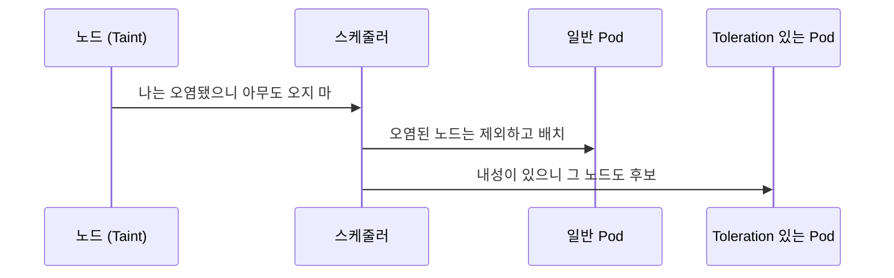

# Kubernetes Taint와 Toleration, 이름에 답이 있다

Kubernetes를 처음 배울 때 Taint와 Toleration은 외워야 할 설정 항목처럼 느껴진다. 그런데 두 단어의 원래 뜻을 알면 동작 원리가 이름 안에 이미 들어 있다는 걸 알게 된다. 용어를 제대로 알면 오래 기억에 남고, 기억에 남으면 이해도 쉬워진다. 이 글은 어원에서 출발해서 Kubernetes의 동작으로 넘어간다.

## Taint: 물들이다, 오염시키다

Taint는 고대 프랑스어에서 "염색하다"를 뜻하는 teint(라틴어 tingere에서 왔다)와, "감염시키다"를 뜻하는 attaint의 영향을 받아 만들어진 단어다.

깨끗한 물에 잉크가 한 방울 떨어지면 물 전체의 색이 변한다. Taint는 이렇게 무언가가 더럽혀지거나 악취가 배는 것을 뜻한다.

Kubernetes에서 노드에 Taint를 설정한다는 것은 그 노드에 "오염 표시"를 묻혀 놓는 것이다. 일반 Pod는 이 표시가 있는 노드를 피한다. 스케줄러가 그 노드에는 Pod를 배치하지 않는다.

## Toleration: 견뎌냄, 내성

Toleration은 라틴어 tolerare에서 왔다. "무거운 짐을 지탱하다", "고통을 견뎌내다"라는 뜻이다. 불쾌한 환경이나 독성을 참고 견디는 능력을 가리킨다. 의학에서 약물 "내성"을 tolerance라고 부르는 것과 같은 뿌리다.

Pod에 Toleration을 부여한다는 것은 그 오염을 견딜 수 있는 방독면을 씌워 주는 것과 같다. 남들은 다 피하는 Taint 노드라도, 맞는 Toleration을 가진 Pod는 그 노드에 배치될 수 있다.

## 정리하면 이런 대화다



- 노드는 "나한테는 독성(Taint)이 있으니 오지 마"라고 밀어낸다.
- Pod는 "나는 내성(Toleration)이 있어서 거기 들어가도 괜찮다"라고 답한다.

주체가 노드라는 점이 중요하다. 밀어내는 쪽은 노드이고, Pod는 그 밀어냄을 면제받을 뿐이다.

## Affinity와 방향이 반대다

비슷한 목적으로 쓰이는 NodeAffinity와 비교하면 이름의 은유가 더 선명해진다.

Affinity는 라틴어 ad(~로)와 finis(경계)에서 온 단어로, "경계가 맞닿아 있다"는 데서 "친화력, 끌어당기는 힘"이라는 뜻이 나왔다. Pod가 노드를 끌어당기는 방향이다. "나는 GPU가 있는 노드가 좋으니 거기로 가겠다"가 Affinity다.

Taint와 Toleration은 반대로 노드가 Pod를 밀어내는 방향이다. 그래서 두 도구를 함께 쓰는 경우도 많다. 특정 노드를 전용으로 만들고 싶다면 Taint로 다른 Pod를 밀어내고, Affinity로 원하는 Pod를 끌어온다.

## 실제 설정에서 보면

control-plane 노드에는 기본적으로 Taint가 걸려 있다. 일반 워크로드가 컨트롤 플레인에 올라가지 않게 하기 위해서다.

```bash
kubectl taint nodes node1 key=value:NoSchedule
```

이 명령은 node1에 `key=value` 오염 표시를 붙이고, 효과(effect)로 `NoSchedule`을 지정한다. 이 Taint를 견디지 못하는 Pod는 node1에 스케줄링되지 않는다.

Toleration은 Pod 스펙에 이렇게 적는다.

```yaml
tolerations:
  - key: "key"
    operator: "Equal"
    value: "value"
    effect: "NoSchedule"
```

예를 들어 Traefik 같은 인프라 Pod에 control-plane 노드의 Taint를 견디는 Toleration을 주면, 일반 Pod는 못 오는 control-plane 노드에도 배치될 수 있다. 설정 파일에 tolerations가 보이면 "이 Pod는 오염된 노드에도 들어갈 수 있다"고 읽으면 된다.

## Recap

Taint는 "오염시키다"라는 뜻 그대로 노드에 붙이는 기피 표시이고, Toleration은 "견뎌내다"라는 뜻 그대로 Pod가 그 표시를 견딘다는 선언이다. 밀어내는 주체는 노드이고, Toleration은 그 밀어냄을 면제해 주는 장치다. Pod가 노드를 끌어당기는 Affinity와는 방향이 반대다. 그래서 둘을 함께 쓰면 특정 노드를 특정 Pod 전용으로 만들 수 있다.
