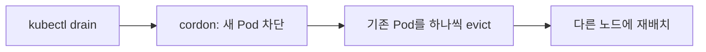

# Kubernetes Cordon, Drain, Eviction: 노드를 비우는 세 단어

노드를 점검하거나 업그레이드하려면 그 노드 위의 Pod를 다른 곳으로 옮겨야 한다. 이때 쓰는 명령이 `cordon`과 `drain`이고, 그 밑에서 일어나는 일이 `eviction`이다. 세 단어는 서로 다른 단계를 가리킨다. 01-taint-toleration.md에서 본 Taint와도 연결되는 내용이다.

## Cordon: 둘러친 줄

Cordon은 프랑스어 cord(끈, 줄)에서 온 단어로, 원래 "둘러친 줄"이라는 뜻이다. 전염병이 돌 때 지역을 막는 방역선(sanitary cordon)이나, 사건 현장에 치는 통제선이 대표적이다. 선 안으로 새로 들어오는 것을 막는다.

`kubectl cordon`은 노드에 통제선을 치는 명령이다. 노드는 "스케줄링 불가" 상태가 되고, 새 Pod는 그 노드에 배치되지 않는다. 이미 떠 있는 Pod는 그대로 남는다. 방역선이 새 출입만 막는 것과 같다.

## Drain: 물을 빼내다

Drain은 고대 영어에서 "걸러내다, 물을 빼내다"를 뜻하는 말에서 왔다. 욕조의 마개를 뽑아 물을 빼는 모습이다.

`kubectl drain`은 노드 위에 있는 Pod를 모두 내보낸다. 동작 순서는 이렇다.



Drain은 cordon을 먼저 수행하고, 그다음 기존 Pod를 내보낸다. 통제선을 치고 나서 안에 있는 것을 비우는 순서다. 선을 안 치고 비우면 비우는 동안 새 Pod가 계속 들어올 수 있기 때문이다.

## Eviction: 퇴거시키다

Eviction은 라틴어 evincere(이겨서 되찾다)에서 왔고, 법률에서 임차인을 "퇴거시키는 것"을 뜻한다. 집주인이 정당한 절차로 세입자를 내보내는 모습이다.

이 비유가 정확한 이유가 있다. Kubernetes의 eviction은 Pod를 그냥 죽이는 것이 아니라 정해진 절차를 따르기 때문이다. Drain은 Eviction API를 통해 Pod를 내보내고, 이때 PodDisruptionBudget(PDB)을 존중한다. "서비스가 최소 N개는 떠 있어야 한다"는 약속을 어기게 되면 퇴거를 미룬다. 세입자 보호 규정이 있는 퇴거 절차와 같다.

노드의 메모리나 디스크가 부족할 때 kubelet이 스스로 Pod를 내보내는 경우도 eviction이라 부른다. 두 경우 모두 "쫓아낸다"는 같은 뜻이다.

## 명령 예시

```bash
kubectl cordon node1                      # 새 Pod 차단
kubectl drain node1 --ignore-daemonsets   # 기존 Pod 퇴거
kubectl uncordon node1                    # 통제선 해제
```

`--ignore-daemonsets`가 붙는 이유는 04-pod-sidecar-daemon.md에서 다룬다. DaemonSet Pod는 노드마다 하나씩 있어야 하는 Pod라서 drain으로 내보내도 곧바로 되살아나기 때문이다.

## Recap

Cordon은 둘러친 줄처럼 새 Pod의 진입만 막고, Drain은 물을 빼내듯 기존 Pod를 모두 내보낸다. Drain 안에서 실제로 Pod를 내보내는 행위가 Eviction이고, 법률의 퇴거처럼 PDB 같은 절차를 지킨다. 순서는 항상 차단(cordon), 비우기(drain) 순이다.
