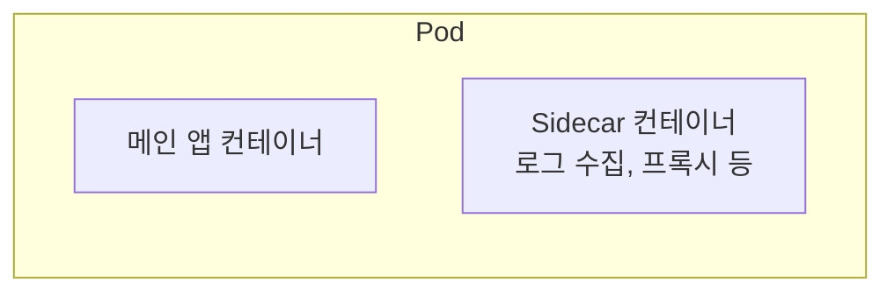

# Kubernetes Pod, Sidecar, Daemon: 비유로 붙은 이름들

Pod, Sidecar, Daemon은 모두 일상어나 시스템 용어에서 비유로 가져온 이름이다. 컨테이너 몇 개가 어떻게 묶이는지를 이름이 그대로 보여 준다.

## Pod: 완두콩 꼬투리, 고래 떼

Kubernetes 공식 문서는 Pod를 설명하며 "a pod of whales or pea pod(고래 떼 또는 완두콩 꼬투리)"라고 비유를 직접 밝힌다.

- 완두콩 꼬투리: 콩알 여러 개가 한 꼬투리에 들어 있다. 컨테이너 여러 개가 한 Pod에 들어 있는 모습이다.
- 고래 떼: Docker의 로고가 고래이기 때문에, 컨테이너(고래)가 모인 무리를 Pod라고 불렀다.

두 비유가 공통으로 가리키는 것은 "함께 움직이는 한 묶음"이다. 같은 Pod의 컨테이너들은 같은 노드에 배치되고 네트워크와 볼륨을 공유한다.

## Sidecar: 오토바이 옆자리

Sidecar는 오토바이 옆에 다는 보조석 수레다. 오토바이가 달리면 옆자리도 같이 달린다. 떨어질 수 없고, 주인공은 오토바이다.

Kubernetes에서는 메인 컨테이너 옆에 붙어서 같은 Pod 안에서 함께 도는 보조 컨테이너를 가리킨다. 로그 수집, 프록시, 인증서 갱신 같은 보조 역할을 맡는다.

최근 Kubernetes에는 사이드카를 공식 기능으로 지원하는 방식이 들어왔다. initContainers에 `restartPolicy: Always`를 주면, 메인 컨테이너보다 먼저 시작해서 끝까지 같이 도는 사이드카가 된다.

## Daemon: 수호령

Daemon은 그리스어 daimon(수호령, 보이지 않는 정령)에서 왔다. Unix에서 사용자 눈에 안 보이게 백그라운드에서 계속 도는 프로세스를 daemon이라 부르는 데서 나온 이름이다. 맥스웰의 도깨비(Maxwell's demon)에서 땄다고 알려져 있다.

DaemonSet은 이 이름을 가져와서 "모든 노드에 하나씩 꼭 떠 있어야 하는 Pod"를 만든다. 노드가 추가되면 자동으로 하나 더 생기고, 노드가 사라지면 같이 사라진다. 로그 수집기나 모니터링 에이전트처럼 노드마다 상주해야 하는 것에 쓴다.

02-cordon-drain-eviction.md에서 drain을 할 때 `--ignore-daemonsets`를 붙이는 이유가 여기에 있다. DaemonSet Pod는 노드마다 있어야 하는 Pod라서, 내보내도 곧바로 같은 노드에 되살아난다.

## Recap

Pod는 완두콩 꼬투리나 고래 떼처럼 함께 움직이는 컨테이너 묶음이다. Sidecar는 오토바이 옆자리처럼 메인 컨테이너 곁에 붙어 다니는 보조 컨테이너다. Daemon은 눈에 안 보이게 상주하는 수호령이라는 뜻으로, DaemonSet은 모든 노드에 하나씩 상주하는 Pod를 보장한다.
