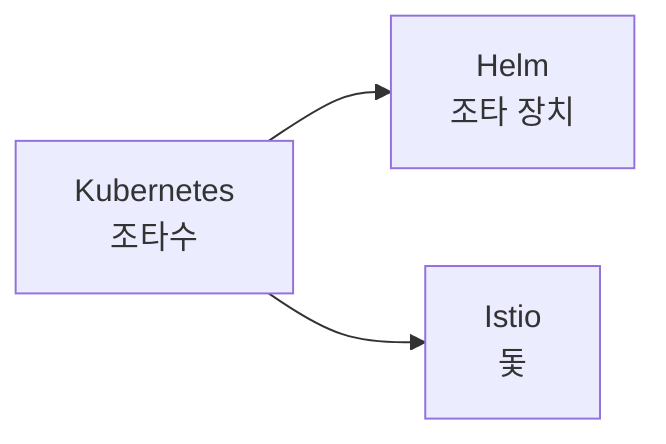

# Kubernetes, Helm, Istio: 항해에서 온 이름들

Kubernetes 생태계에는 배와 항해에서 따온 이름이 많다. 이름만 이어 보면 "배를 운항하는 이야기"가 하나 만들어진다.

## Kubernetes: 조타수

Kubernetes는 그리스어 κυβερνήτης(퀴베르네테스)에서 왔고, 배의 조타수나 키잡이를 뜻한다. 컨테이너라는 짐을 실은 배들을 목적지로 이끄는 키잡이라는 은유다.

이 단어는 영어 곳곳에 퍼져 있다. govern(통치하다), government, cybernetics(사이버네틱스) 모두 같은 뿌리다. "방향을 잡고 이끈다"는 개념이 통치와 제어로 확장된 것이다.

Kubernetes를 줄여서 K8s라고 쓰는 이유는 K와 s 사이에 글자가 8개 있기 때문이다.

## Helm: 조타 장치

Helm은 배의 키(타륜, 조타 장치) 자체를 뜻하는 말이다. Kubernetes가 키잡이라면, Helm은 그가 잡는 키다. Kubernetes를 조작하는 도구에 그 이름을 붙였다.

Helm이 다루는 패키지 묶음은 **Chart**라고 부른다. 항해도(sea chart)에서 왔다. 어디로 어떻게 갈지 적힌 지도처럼, 애플리케이션을 클러스터에 배포하는 방법을 담은 문서라는 뜻이다.

## Istio: 돛

Istio는 서비스 메시(service mesh)를 구현하는 도구이고, 이름은 그리스어로 "돛(sail)"을 뜻한다. Kubernetes라는 배를 움직이는 돛이라는 이어짐이다.

## 한 줄로 이어 보면

조타수(Kubernetes)가 키(Helm)를 잡고 돛(Istio)을 펴서 컨테이너를 실은 배를 이끈다. 이름들이 우연히 모인 것이 아니라 하나의 이미지를 공유한다는 점을 알면 외우기 쉽다.

## Recap

Kubernetes는 조타수, Helm은 조타 장치, Istio는 돛이라는 뜻이다. 모두 항해 은유라서 하나의 이야기로 묶어 기억할 수 있다. Chart도 항해도에서 왔다. K8s는 K와 s 사이 글자가 8개라서 붙은 약칭이다.
