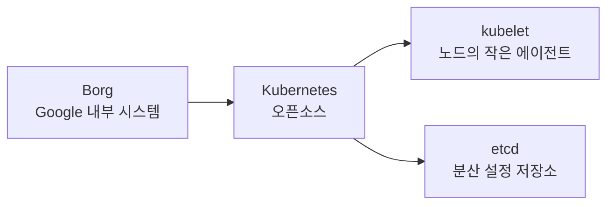

# Kubelet, etcd, Kind, Borg: 줄임말에 숨은 뜻

앞의 글들이 일상어에서 온 비유였다면, 이번 글의 이름들은 줄임말과 조합어다. 한 번 풀어 보면 이름이 곧 설명이 된다.

## Kubelet: 작은 Kubernetes

Kubelet은 Kubernetes에 "작다"는 뜻의 접미사 -let을 붙인 이름이다. 영어의 booklet(작은 책), piglet(새끼 돼지)과 같은 방식이다.

각 노드에서 돌면서 그 노드의 Pod 실행을 책임지는 작은 에이전트가 kubelet이다. 클러스터 전체를 이끄는 Kubernetes의 축소판이 노드마다 하나씩 있다고 보면 된다.

## etcd: /etc + distributed

Linux에서 `/etc`는 시스템 설정 파일을 두는 디렉터리다. etcd는 여기에 distributed(분산)의 d를 붙인 이름이다. "분산된 설정 저장소"라는 뜻이다.

Kubernetes는 클러스터의 모든 상태를 etcd에 저장하는 key-value 저장소로 쓴다. 이름이 곧 용도라서, 설정을 분산해서 저장하는 곳이라고 읽으면 된다.

## Kind: Kubernetes IN Docker

Kind는 Kubernetes IN Docker의 약자다. Docker 컨테이너를 노드로 삼아 로컬에 Kubernetes 클러스터를 띄우는 도구다.

## Borg: Kubernetes의 전신

Kubernetes는 Google 내부의 클러스터 관리 시스템 Borg에서 나왔다. Borg라는 이름은 Star Trek의 Borg 종족에서 땄다. 개체가 모여 하나의 집합체로 움직이는 모습이 서버들이 한 시스템으로 동작하는 것과 닮았다.

Kubernetes의 초기 코드명은 Star Trek의 인물 "Seven of Nine"을 딴 것으로 알려져 있다. 로고의 일곱 개 바퀴살이 이를 가리킨다.

## Recap

Kubelet은 작은 Kubernetes, etcd는 `/etc`에 distributed를 붙인 분산 설정 저장소, Kind는 Kubernetes IN Docker의 약자다. Kubernetes의 전신 Borg와 로고의 일곱 바퀴살은 모두 Star Trek에서 왔다. 줄임말과 조합어는 풀어 읽으면 그대로 설명이 된다.
