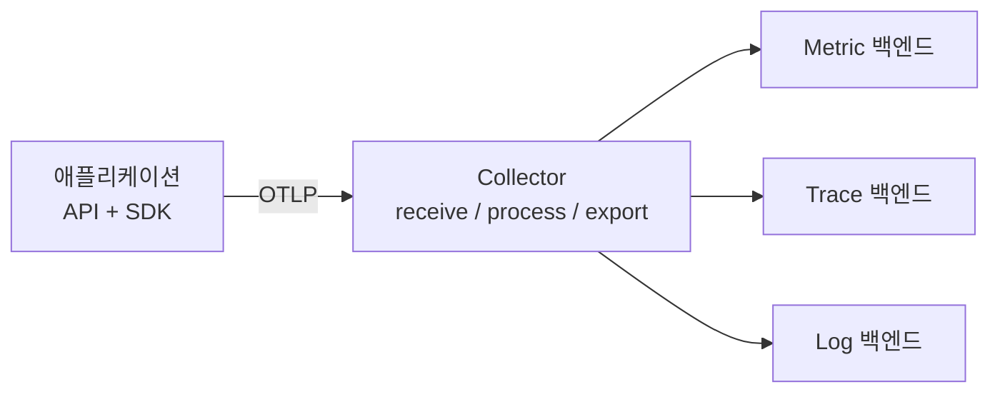
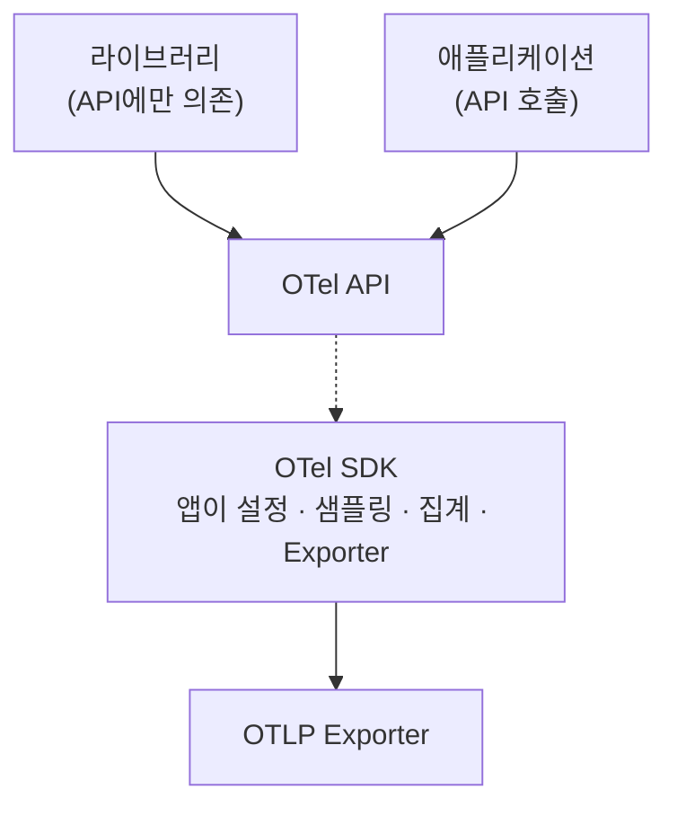

# OpenTelemetry는 무엇을 표준화하나: Signal 모델과 API·SDK·Collector

지난 글에서 기존 APM의 한계를 세 가지로 정리했다. 계측이 백엔드에 결합되고, 전파 헤더가 제각각이고, 연결은 벤더 안에서만 된다.

OpenTelemetry(이하 OTel)는 이 세 가지를 겨냥한다. 이 글은 OTel이 정확히 무엇을 표준화하는지, 데이터는 어떤 모양인지, 구성 요소는 왜 나뉘어 있는지를 다룬다.

## OTel은 백엔드가 아니다

가장 흔한 오해부터 짚는다. OTel은 데이터를 저장하거나 보여 주는 제품이 아니다. 데이터를 만들고 내보내는 쪽의 규격과 도구 모음이다.

- 사양(Specification): 세 Signal의 데이터 모델과 동작 규칙
- Semantic Conventions: 속성 이름과 값의 약속. `http.request.method`처럼 이름을 통일한다
- API와 SDK: 언어별 구현. Java, Go, Python, JS 등
- OTLP: 데이터를 내보낼 때 쓰는 전송 프로토콜
- Collector: 데이터를 받아서 가공하고 다른 곳으로 보내는 독립 프로세스

저장과 분석은 Prometheus, Tempo, Loki, Datadog 같은 백엔드가 맡는다. OTel이 통일하는 구간은 계측과 전송이다.

앱은 OTLP로 한 곳에만 보낸다. 백엔드를 바꿔도 앱의 계측 코드는 그대로이고 Collector 설정만 바꾼다. 지난 글의 첫 번째 한계, 계측과 백엔드의 결합이 여기서 끊어진다.

## 세 Signal의 데이터 모델

### Trace: Span의 트리

Trace는 Span들의 모음이다. Span 하나는 요청이 거친 작업 하나에 해당한다. 주요 필드는 이렇다.

- trace_id: 같은 요청에 속한 모든 Span이 공유한다
- span_id, parent_span_id: Span 간 부모 자식 관계를 만든다. 이 관계가 트리가 된다
- name, 시작·종료 시각: 작업 이름과 걸린 시간
- kind: 이 Span이 어떤 종류의 작업인지 알려 준다. 값은 다섯 가지다
  - SERVER: 동기로 들어온 원격 호출을 처리한다. 들어온 HTTP 요청이 대표적이다
  - CLIENT: 동기로 나가는 원격 호출이다. HTTP 요청, DB 호출이 해당한다
  - PRODUCER: 나중에 비동기로 처리될 작업을 만든다. 큐에 메시지를 넣는 쪽이다
  - CONSUMER: PRODUCER가 만든 작업을 처리한다. PRODUCER Span이 끝나고 한참 뒤에 시작될 수 있다
  - INTERNAL: 프로세스 경계를 넘지 않는 작업이다. 함수 호출이 해당하고, kind를 지정하지 않으면 기본값이다
- attributes: 키-값 메타데이터다. 키는 문자열이고, 값은 문자열, 불리언, 정수, 실수 또는 이들의 배열이다. 샘플링 결정에 쓰일 수 있으니 가능하면 Span 생성 시점에 넣는다
- events: Span 안의 한 시점에 붙이는 타임스탬프 주석이다. 시점이 중요하면 event, 아니면 attribute를 쓴다
- links: 부모 자식은 아니지만 인과 관계가 있는 다른 Span을 가리킨다. 큐에 쌓였다가 비동기로 처리되는 작업이 이전 작업과 이어질 때 쓴다. 선택 사항이다
- status: Unset, Error, Ok. 기본값은 Unset으로 에러 없이 끝났다는 뜻이다. Error는 작업 중 에러가 났다는 뜻이다. Ok는 개발자가 명시적으로 성공이라고 확정하는 값이라 보통 직접 설정할 일이 없다

각 Span은 span context라는 불변 객체를 가진다. trace_id, span_id, trace flags, trace state가 들어 있다. 서비스 경계를 넘을 때 이 context를 헤더로 전달하면 다음 서비스가 그 Span의 자식으로 이어 붙인다. 이 전달이 3회차 주제인 Context Propagation이다.

### Metric: Instrument로 만들고 집계해서 내보낸다

Metric은 Instrument라는 도구로 측정값을 기록한다. 종류에 따라 의미가 다르다.

- Counter: 증가만 하는 값. 계기판의 주행 거리처럼 누적 합계에 쓴다. 요청 수, 읽은 바이트
- UpDownCounter: 늘고 줄 수 있는 값. 큐 길이, 활성 연결 수
- Gauge: 읽는 시점의 현재 값. 연료 게이지 같은 값이다
- Histogram: 값을 클라이언트 쪽에서 집계해 분포를 남긴다. 요청 지연 시간처럼 "1초 안에 끝난 요청이 몇 개인가"를 알고 싶을 때 쓴다

Counter, UpDownCounter, Gauge에는 비동기(Asynchronous) 버전이 있다. 값을 기록할 때마다 호출하는 동기 방식과 달리, 내보내는 주기마다 한 번 값을 읽어 간다. 이미 집계된 총량이나 현재 값만 손에 있을 때 쓴다. 큐의 현재 크기가 예다.

Instrument는 측정값을 그대로 보내지 않는다. SDK가 일정 주기로 집계(aggregation)한 데이터 포인트를 내보낸다. 그래서 Metric 비용이 요청 수와 무관하게 일정하다. Instrument마다 기본 집계 방식이 정해져 있고, View로 바꿀 수 있다.

Histogram에는 두 가지 형태가 있다. 기본은 경계를 직접 정하는 explicit bucket이다. 값의 범위가 넓을 때는 경계를 지수 간격으로 잡는 ExponentialHistogram이 작은 상대 오차로 넓은 범위를 담는다.

집계에는 temporality라는 선택지가 있다.

- Cumulative: 매 포인트가 시작 시점부터 지금까지의 전체 구간을 덮는다. 보내는 쪽이 시계열마다 상태를 유지해야 한다
- Delta: 매 포인트가 직전 포인트가 끝난 지점에서 시작한다. 보내는 쪽 상태가 적고, 받는 쪽에서 누적으로 바꾸거나 바로 rate를 계산할 수 있다

단조 증가하는 합계에는 cumulative가 흔하고, Prometheus가 그 예다. 어느 쪽을 쓰느냐는 카디널리티 한도에도 영향을 준다. Delta는 매 주기마다 상태를 초기화하므로 한 주기 안에 나온 조합만 한도에 걸린다. Cumulative는 상태를 주기 너머로 유지하므로 한도에 닿으면 새 조합이 프로세스를 재시작할 때까지 overflow로 처리된다.

Metric에서 Trace로 건너가는 고리도 데이터 모델에 있다. Exemplar는 Metric 측정값 하나를 trace ID, span ID 같은 OTel context와 연결해 기록한 값이다. 사용자는 느린 구간 버킷에서 그 요청의 Trace로 넘어갈 수 있다. 지난 글의 다이어그램에서 Metric과 Trace 사이의 화살표가 이것이다.

### Log: LogRecord 한 건

LogRecord의 최상위 필드는 다음과 같다.

- Timestamp, ObservedTimestamp: 이벤트가 발생한 시각, 관측된 시각
- SeverityText, SeverityNumber: 로그 레벨을 문자와 숫자로
- Body: 로그 내용
- TraceId, SpanId, TraceFlags: Trace와 잇는 고리
- Resource, InstrumentationScope, Attributes: 누가 만든 로그인지와 부가 정보
- EventName: 이벤트의 종류

SDK나 자동 계측이 켜져 있으면 기존 로그에 현재 활성 Trace와 Span의 ID가 코드 수정 없이 붙는다. Log와 Trace가 이어지는 지점이다.

기존 로깅 코드를 갈아엎지 않게 하는 설계도 있다. OTel에는 두 가지 Logs API가 있다. Logs Bridge API는 로깅 라이브러리를 만드는 쪽을 위한 것이고, 애플리케이션 개발자가 직접 호출하지 않는다. 개발자는 쓰던 로거(logback, log4j 등)를 그대로 쓰고, 거기에 appender 또는 bridge를 붙인다. 이 bridge가 로그를 OTel로 넘겨 Log Record Exporter가 내보낸다. 애플리케이션 코드가 직접 호출할 수 있는 공개 Logs API도 따로 있지만, 현실에서는 기존 로깅 라이브러리를 경유하는 쪽이 대부분이다.

## Resource와 Scope: 누가 만든 데이터인가

세 Signal 모두에 공통으로 붙는 두 가지 정보가 있다.

- Resource: 데이터를 만든 주체를 설명하는 속성들이다. `service.name`, `service.version`, `deployment.environment.name`, 호스트나 컨테이너 정보가 들어간다. 쿠버네티스 컨테이너에서 도는 프로세스라면 pod 이름, namespace, deployment 이름이 붙는다. TracerProvider나 MeterProvider를 만드는 초기화 시점에 붙고, 그 뒤로는 바꿀 수 없다. 그 Provider에서 나온 모든 Span과 Metric이 같은 Resource를 가진다
- InstrumentationScope: 데이터를 만든 계측 라이브러리의 이름과 버전. HTTP 서버 계측이 만든 Span인지 JDBC 계측이 만든 Span인지 구분한다

`service.name`을 설정하지 않으면 SDK는 `unknown_service`라는 기본값을 쓴다. 코드나 환경 변수 `OTEL_SERVICE_NAME`으로 반드시 지정해야 한다. 나머지 속성은 resource detector가 OS, 호스트, 프로세스, 컨테이너, 클라우드 정보를 자동으로 채우거나 `OTEL_RESOURCE_ATTRIBUTES`로 직접 넣는다.

지난 글에서 "같은 프로세스에는 같은 service.name"이 세 Signal을 묶는 열쇠라고 했다. 그 약속이 Resource다. Semantic Conventions는 이 속성들의 이름을 통일해서 팀마다 `status`, `httpStatus`로 다르게 쓰는 일을 막는다.

## API와 SDK는 왜 나뉘어 있나

OTel의 언어별 구현은 API와 SDK 두 층이다.

- API: 계측 코드가 호출하는 인터페이스. Span을 만들고 Counter를 올리는 메서드가 여기 있다. 구현은 없다
- SDK: API의 실제 구현. 샘플링, 집계, 배치 처리, Exporter 연결을 담당한다

공식 문서의 정의로는 API가 데이터를 만들고 연결하는 데이터 타입과 연산이고, SDK는 그 API의 언어별 구현이며 설정, 처리, 내보내기까지 맡는다. API는 "추상과 아무 일도 하지 않는 구현"의 모음이다.

SDK를 등록하지 않으면 API 호출은 아무 일도 하지 않는다(no-op). 공식 문서는 이때 계측이 아무것도 하지 않고 애플리케이션 성능에도 영향을 주지 않는다고 설명한다.

이렇게 나눈 이유는 라이브러리 때문이다. 공식 문서도 "라이브러리는 OpenTelemetry API만 사용해야 한다"고 못 박고 있다. Spring, Kafka 클라이언트, JDBC 드라이버 같은 라이브러리가 자체 계측을 넣고 싶다고 하자. 라이브러리가 SDK에 의존하면 앱이 쓰는 SDK 버전, 설정과 충돌한다. API에만 의존하면 충돌이 없다. 라이브러리는 API로 계측만 해 두고, 어떻게 샘플링하고 어디로 보낼지는 앱이 SDK로 결정한다.

SDK가 없으면 점선이 끊겨서 계측은 no-op이 된다. 계측은 공짜로 넣어 두고, 켤지 말지는 앱이 정하는 구조다.

## Collector는 왜 따로 있나

앱의 SDK가 백엔드로 직접 보낼 수도 있다. 그런데 Collector를 중간에 두면 이점이 생긴다.

- 앱이 백엔드를 몰라도 된다. 전송 대상이 바뀌어도 앱은 재배포하지 않는다
- 재시도, 배치, 압축을 앱 대신 처리한다. 백엔드가 느려져도 앱 부담이 줄어든다
- 민감한 속성 제거, 샘플링, 속성 추가 같은 가공을 한 곳에서 한다
- 여러 백엔드로 동시에 보낼 수 있다

공식 문서는 Collector를 벤더 중립 프록시라고 부른다. OTLP뿐 아니라 Jaeger, Prometheus 같은 여러 형식으로 받을 수 있다.

Collector는 파이프라인 구조다. 파이프라인 하나는 Signal 하나(trace, metric, log)만 다룬다. 그 안에서 Receiver가 받고, Processor가 순서대로 가공하고, Exporter가 내보낸다. Processor는 선택 사항이고 데이터를 바꾸거나 버리거나(샘플링) 새로 만들 수 있다. 파이프라인이 다루는 Signal을 지원하지 않는 컴포넌트를 넣으면 설정 로딩이 실패한다.

컴포넌트는 여러 파이프라인에서 재사용할 수 있고, 종류마다 방식이 다르다.

- Receiver: 여러 파이프라인에 넣으면 인스턴스는 하나이고 같은 데이터가 각 파이프라인으로 나뉜다. 호출이 동기라서 한 파이프라인의 Processor가 막히면 Receiver와 다른 파이프라인까지 멈출 수 있다
- Processor: 같은 이름을 여러 파이프라인에서 써도 파이프라인마다 독립된 인스턴스와 상태를 가진다
- Exporter: 여러 파이프라인의 데이터를 하나의 Exporter가 받을 수 있다

배치 패턴(Agent, Gateway)과 Processor 설계, 이런 back pressure 문제는 뒤 회차에서 따로 다룬다.

## Signal은 셋만이 아니다

공식 문서가 지금 지원한다고 분류하는 Signal은 Trace, Metric, Log에 Baggage를 더한 넷이다. Baggage는 다른 Signal 사이에서 context 정보를 실어 나르는 용도라 활동 자체를 기록하지는 않는다. Event는 Log의 하위 유형으로 개발 중이고, Profiles(코드 수준의 리소스 사용 기록)도 아직 개발 단계다. 이 시리즈는 앞의 셋에 집중한다.

## OTLP: 하나의 프로토콜

OTLP는 세 Signal을 같은 틀로 실어 나르는 프로토콜이다. gRPC(기본 포트 4317)와 HTTP(기본 포트 4318)를 지원한다. HTTP는 Signal별 경로로 POST한다. `/v1/traces`, `/v1/metrics`, `/v1/logs`다. 인코딩은 binary protobuf(`application/x-protobuf`)와 JSON(`application/json`) 두 가지이고, 전송 압축은 none과 gzip을 지원한다. 사양이 기본 호스트 이름은 정하지 않으므로 `<host>:4317`, `<host>:4318`처럼 호스트는 직접 지정한다.

데이터 구조는 Resource → Scope → 데이터 순으로 묶인다. 같은 Resource에서 나온 Span, Metric, LogRecord가 한 묶음 안에 들어간다. 그래서 수신 쪽은 "어느 서비스의 어느 계측 라이브러리가 만든 데이터인가"를 항상 알 수 있다.

헤더가 제각각이던 문제도 같은 방식으로 풀린다. 서비스 사이의 trace 전파는 OTLP가 아니라 W3C Trace Context(`traceparent` 헤더)라는 별도 표준을 기본으로 쓴다. 이 부분은 3회차에서 다룬다.

## 정리

OTel은 계측과 전송을 표준화한다. 데이터 모델(Trace, Metric, Log)과 공통 속성(Resource, Semantic Conventions)과 전송 규격(OTLP)을 통일했다. 구성 요소는 역할로 나뉜다. API는 계측 인터페이스, SDK는 앱이 쥔 구현, Collector는 앱 밖의 파이프라인이다.

지난 글의 세 가지 한계와 대응해 보면 다음과 같다.

- 계측이 백엔드에 결합된다 → API로 계측하고 OTLP로 내보내므로 백엔드는 Collector 뒤로 숨는다
- 전파 헤더가 제각각이다 → W3C Trace Context를 기본으로 쓴다
- 연결은 벤더 안에서만 된다 → 세 Signal이 같은 Resource와 trace_id를 공유한다

다음 글에서는 코드를 한 줄도 고치지 않고 Java Agent로 계측하는 Zero-Code Instrumentation을 다룬다.

## 참고 자료

- OpenTelemetry 공식 문서: Concepts (Signals, Components, Context propagation)
- OpenTelemetry Specification: Trace, Metrics, Logs Data Model
- OTLP Specification
