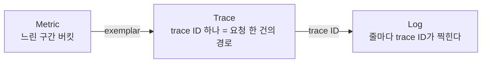

# Observability란 무엇이고, 왜 OpenTelemetry가 나왔나

MSA에서 결제 API가 오후 3시부터 느려졌다고 해보자. 알람은 울렸다. p99가 임계치를 넘었다는 것까지는 안다. 그런데 "왜"는 어디에도 적혀 있지 않다.

이 글은 그 "왜"에 답하려면 무엇이 필요한지, 그리고 그 필요가 어떻게 OpenTelemetry라는 표준으로 이어졌는지를 정리한다.

## Monitoring과 Observability는 다른 질문에 답한다

Monitoring은 아는 질문에 답한다. "CPU가 80%를 넘었나", "에러율이 1%를 넘었나"처럼 질문을 미리 정해 두고 지표와 알람을 건다. "무엇이 깨졌는가"에 빠르게 답한다.

Observability는 모르는 질문에 답할 수 있는 성질이다. 제어이론에서는 외부 출력만 보고 내부 상태를 얼마나 추론할 수 있는가를 뜻한다. 소프트웨어로 옮기면 이렇다. 배포 전에 생각하지 못한 질문을, 코드를 다시 배포하지 않고 이미 남겨 둔 데이터만으로 답할 수 있는가.

p99 지연 사례로 보면 차이가 분명하다.

- 모니터링이 답하는 것: "p99가 임계치를 넘었다"
- 관측성이 있으면 이어서 물을 수 있다: 어느 하위 서비스에서 시간이 늘었나, 특정 사용자나 결제 수단에 몰려 있나, 느린 요청의 공통점이 그 시각의 배포인가

어떤 축으로 자를지는 사고가 난 뒤에야 정해진다. 그래서 대시보드를 미리 만들어 둘 수 없다.

MSA가 되면서 이런 모르는 질문은 세 가지로 늘어났다.

- 호출 경로: 요청 하나가 몇 개 서비스를 거쳤는지 코드만 봐서는 알기 어렵다
- 구간별 시간: 전체 3초 중 어느 구간이 가장 오래 걸렸나
- 연결 고리: A 서비스의 로그와 B 서비스의 로그가 같은 요청의 것인지 어떻게 아는가

세 질문 모두 요청 하나를 서비스 경계 너머로 따라갈 수 있어야 답이 나온다.

## 세 가지 Signal: Metric, Log, Trace

관측성의 재료를 Signal이라 부른다. Metric, Log, Trace 세 가지가 있고, 같은 사실을 서로 다른 해상도로 기록한 것이다.

**Metric**
- 일정 간격으로 집계한 숫자의 시계열이다. 요청 수, 에러율, p99, 힙 사용량이 여기 속한다
- 추세와 정상 범위 판단에 강하다
- 비용은 요청 수와 무관하게 거의 일정하다. 싸고 오래 보관할 수 있어 알람의 재료로 쓴다
- 개별 요청은 볼 수 없다. 라벨을 늘리면 시계열 수가 폭발한다

**Log**
- 시각이 붙은 이벤트 한 줄이다. 예외 스택, 입력값, 분기 결과를 담는다
- "그때 정확히 무슨 일이 있었나"에 강하다
- 비용은 요청 수에 비례하고 셋 중 가장 크다
- 비정형이면 집계가 어렵고, 여러 서비스에 흩어진 로그에서 요청 하나를 잇기 힘들다

**Trace**
- 요청 한 건이 거쳐 간 작업(span)들의 트리다
- "어디서 시간을 썼나, 어느 호출이 실패했나"에 강하다
- 비용은 요청 수에 비례하지만 샘플링으로 조절한다
- 전수 저장이 어렵고 로그만큼 상세하지 않다

### 셋을 잇는 열쇠는 공통 식별자다

Signal 하나로는 부족하다. 중요한 건 셋이 서로 건너갈 수 있느냐다.

세 Signal이 따로 저장되면 과정이 전부 수작업이 된다. Metric 대시보드에서 이상을 확인하고, 그 시각의 로그를 열어 에러를 찾고, trace ID가 찍혀 있기를 바라며 APM을 검색한다. 하나라도 어긋나면 흐름이 끊긴다.

공통 식별자로 이어 두면 달라진다. Metric의 튀는 점에서 그 요청의 Trace로, Trace의 한 구간에서 그 시점의 Log로 넘어갈 수 있다.

필요한 약속은 두 가지다.

- 같은 요청에는 같은 trace_id를 남긴다
- 같은 프로세스에는 같은 service.name을 남긴다

서비스 이름, 버전, 인스턴스, 환경 같은 리소스 속성도 세 Signal에 같은 이름과 형식으로 붙어 있어야 "이 서비스의 이 버전"으로 묶어 볼 수 있다. 이 이름과 형식을 통일하는 것이 OpenTelemetry가 하는 일의 큰 부분이다.

## 왜 표준이 필요해졌나

Signal마다 도구 생태계가 달라서 계측 코드가 백엔드에 결합되어 있었다.

- Metric: Prometheus client, StatsD, Dropwizard, Micrometer. 이름 규칙과 전송 형식이 제각각이다
- Trace: Zipkin, Jaeger, Pinpoint. 계측 API도, 요청 사이에 전파하는 헤더(B3, uber-trace-id, 벤더 헤더)도 제각각이다
- Log: logback이나 log4j가 파일로 쓰고 Fluentd, Promtail이 가져간다. trace와 잇으려면 MDC에 trace id를 직접 넣고 하나하나 검색해야 한다

표준화 시도도 둘이었다. OpenTracing(CNCF)은 벤더 중립 trace API만 정의했고, OpenCensus(Google)는 API와 구현, metric까지 묶었다. 이 둘이 합쳐져 2019년에 OpenTelemetry(CNCF)가 시작되었다. 세 Signal, 다언어, 벤더 중립을 하나의 프로젝트로 다룬다.

## 기존 APM은 어디가 아쉬웠나

어떤 APM이든 구조는 4단계다.

1. 계측: 앱 안에서 agent 또는 SDK가 데이터를 만든다
2. 전송: 프로세스 밖으로 벤더 프로토콜 또는 표준 규격으로 내보낸다
3. 저장: 시계열, 문서, 열 지향 저장소 중 하나에 쌓는다
4. 분석: UI, 알람, 대시보드로 보여 준다

도구를 비교할 때는 다섯 축을 본다. 계측 방식(코드를 고치는가, bytecode agent인가), Signal 범위(trace만인가, metric과 log까지인가), 전송 규격(벤더 고유인가, OTLP 같은 표준인가), 배포 모델(SaaS인가, 직접 운영인가), 종속 지점(백엔드를 바꿀 때 애플리케이션에서 무엇을 갈아야 하는가).

**Pinpoint**
- 네이버가 공개한 오픈소스 APM이다. Java는 bytecode를 조작하는 agent라 애플리케이션 코드를 고치지 않아도 된다
- 서버 맵과 call tree가 상세하다
- 자체 프로토콜로 Collector를 거쳐 HBase에 저장한다. 전파 헤더도 자체 규격이다
- trace 중심이라 metric과 log는 다른 도구가 필요하고, HBase 운영 난이도가 높다

**Datadog**
- SaaS다. 호스트마다 Agent를 두고 애플리케이션에는 언어별 트레이싱 라이브러리를 넣는다
- trace, metric, log를 한 UI에서 넘나드는 경험이 좋다
- 호스트 수, 수집량, 커스텀 metric 수 등 여러 축으로 과금해서 규모가 커질수록 비용 설계가 운영 과제가 된다
- 계측 라이브러리와 헤더(x-datadog-*)가 고유하다. 최근에는 OTLP 수신과 OTel Collector 배포판(DDOT)으로 OTel 계측도 받아들인다

**Elastic APM**
- agent → APM Server → Elasticsearch → Kibana 구조다
- 로그를 이미 ES에 넣고 있다면 trace와 같은 저장소를 쓰고 전문 검색도 된다
- 샤드, 인덱스 수명 주기, 메모리 같은 ES 운영 부담이 있고, 시계열 metric은 전용 TSDB보다 비효율적이다
- 자체 agent 대신 OTel 기반 배포판 EDOT을 전면에 내세우는 중이다

**AWS CloudWatch + X-Ray**
- CloudWatch가 metric과 log를, X-Ray가 trace를 맡는다. ALB, Lambda, API Gateway는 계측이 기본 제공된다
- AWS 안에서는 설정이 적고 관리형이다
- trace 모델과 헤더(X-Amzn-Trace-Id)가 고유해서 AWS 밖에서는 쓸 수 없다
- OTel 배포판 ADOT가 나와 있다. 계측은 OTel로 하고 백엔드만 AWS를 쓰라는 방향이다

**오픈소스 조합 (Jaeger 또는 Zipkin + Prometheus + Loki 또는 ES + Grafana)**
- 각 도구가 자기 Signal에 특화되어 있고 비용은 운영뿐이다
- 도구마다 계측 라이브러리와 전송 규격이 달라서(B3, uber-trace-id, pull exporter, 별도 로그 수집기) 세 Signal을 잇는 ID와 속성 맞추기가 전부 사용자 몫이다
- Jaeger는 자체 클라이언트를 폐기하고 OTel SDK를 권장하며, Grafana 스택은 OTLP 수신이 기본이다

도구가 달라도 한계는 셋으로 모인다.

- 계측이 백엔드에 결합된다. 백엔드를 바꾸면 애플리케이션 계측을 갈아엎어야 한다
- 전파 헤더가 제각각이다. A 서비스는 Pinpoint, B 서비스는 Zipkin이면 둘 사이에서 trace가 끊긴다
- 연결은 벤더 안에서만 된다. 로그는 ES에, trace는 Jaeger에 있으면 사용자가 ID를 손으로 찾아 검색해야 한다

그래서 최근에는 계측과 전송은 표준(OTel)에 맡기고 저장과 분석에서 경쟁하는 구도가 늘고 있다. DDOT, EDOT, ADOT가 전부 OTel 배포판이라는 점이 그 증거다.

## 데이터를 모을수록 부딪히는 다섯 가지

데이터를 많이 모을수록 좋지만 비용도 같이 오른다. 실무에서는 이 다섯 쟁점이 반복해서 나온다.

- 카디널리티: metric 라벨 조합 수다. 사용자 ID나 요청 ID처럼 고유한 값을 라벨로 쓰면 시계열이 폭발한다
- 샘플링: trace를 전부 저장할 수는 없다. 앞에서(head) 확률로 자를지, 끝까지 보고(tail) 에러와 느린 요청만 남길지 정해야 한다
- 보존과 비용: 로그를 며칠 두는지, 뜨거운(hot) 저장소와 차가운(cold) 저장소를 나눌지 정해야 한다
- 이름 규칙: http.status_code인지 status인지 httpStatus인지. 팀마다 다르면 대시보드도 알람도 공유되지 않는다
- 파이프라인 신뢰성: 수집기가 밀리면 데이터를 버릴지, 애플리케이션을 막을지 정해야 한다

## 흔한 오해 세 가지

- "로그를 많이 남기면 관측성이 생긴다": 양이 아니라 이을 수 있는가가 핵심이다. ID 없는 로그 100GB보다 trace ID가 찍힌 로그 1GB가 낫다
- "APM을 도입하면 끝난다": APM은 보통 trace와 일부 metric에 강하다. 로그, 비용 모델, 그 벤더 밖으로 나갈 때의 문제는 그대로 남는다
- "trace는 마이크로서비스에서만 필요하다": 모놀리스 안에서도 "이 요청이 DB에 몇 번 갔고 어디서 200ms를 썼나"는 trace가 가장 잘 답한다

## 정리

Monitoring은 미리 정한 질문에 답하고, Observability는 사고 당시에야 떠오르는 질문에 답한다. 그러려면 Metric, Log, Trace가 공통 식별자와 공통 속성으로 이어져 있어야 한다. 기존 APM은 계측, 전파 헤더, 연결이 벤더 안에 갇혀 있어서 이 연결이 자주 끊겼고, OpenTelemetry는 계측과 전송을 표준으로 통일해 그 결합을 끊으려는 시도다.

관측성이란 임의의 축으로 자르고, 다른 데이터와 이을 수 있는가이다.

다음 글에서는 OpenTelemetry가 무엇을 표준화하는지, Trace/Metric/Log의 데이터 모델과 API·SDK·Collector의 분리를 다룬다.

## 참고 자료

- OpenTelemetry 공식 문서: What is OpenTelemetry?, Observability primer
- Observability Engineering (O'Reilly, 2022)
- Peter Bourgon, "Metrics, tracing, and logging" (2017)
- Google SRE Book, Monitoring Distributed Systems
