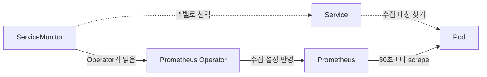

# servicemonitor
참고: prometheus.md, kubernetes-operator.md, crd.md

---

ServiceMonitor는 Prometheus Operator가 등록하는 CRD로, Prometheus가 어떤 앱의 메트릭을 읽을지 적어 두는 안내서다.

## 안내서의 내용

ServiceMonitor에는 세 가지를 적는다. 어느 네임스페이스를 볼지, 어떤 라벨을 가진 Service를 고를지, 그 Service의 어느 이름의 포트에서 읽을지다.

## 동작 순서

Prometheus는 CRD를 모르고 원래의 설정 형식만 안다. 그래서 Operator가 ServiceMonitor를 읽어 그 설정으로 번역해 Prometheus에 반영한다. 점선은 대상을 찾는 관계이고 트래픽이 아니다. 실제 수집은 Prometheus가 Pod IP로 직접 접근해서 한다. Service는 어느 Pod가 대상인지 찾는 데만 쓰인다.

## 자주 어긋나는 지점

라벨은 Pod가 아니라 Service의 라벨과 맞아야 한다. 포트도 번호가 아니라 Service 정의에 붙은 포트 이름이어야 하며, Service에 그 이름이 없으면 대상을 찾지 못한다.

## 왜 쓰는가

ServiceMonitor가 없으면 앱이 배포될 때마다 Prometheus 설정 파일에 수집 대상을 직접 적고 재로드해야 한다. ServiceMonitor를 앱과 함께 배포하면 나머지는 Operator가 처리하고, Pod 수가 변해도 Service를 따라가므로 수집 대상이 알아서 갱신된다.

## Recap

ServiceMonitor는 네임스페이스, Service 라벨, 포트 이름으로 수집 대상을 적은 CRD다. Operator가 이를 Prometheus 설정으로 번역하고, 실제 수집은 Prometheus가 Pod에 직접 접근해서 30초마다 한다. 라벨은 Service 기준이고 포트는 이름 기준이다.
