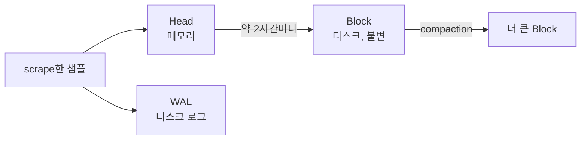

# tsdb
참고: prometheus.md, wal.md, cardinality-dimensionality.md

---

TSDB(Time Series Database)는 시간 순서로만 쌓이는 데이터에 맞춰 설계된 저장 엔진이다. Prometheus에는 별도 DB가 아니라 서버에 내장된 로컬 TSDB가 들어 있다. 이 파일은 그 내부 구조를 다룬다.

## 데이터 모델

저장 단위는 시계열(series)이고, 지표 이름과 레이블 집합이 하나의 시계열을 식별한다. 레이블 조합이 하나라도 다르면 별개의 시계열이다. 각 시계열에는 `(timestamp, value)` 샘플이 시간 순서로 쌓인다. 타임스탬프는 밀리초 정수, 값은 64비트 실수다.

## 쓰기 경로

Head는 아직 쓰기가 진행 중인 최근 구간을 메모리에 들고 있는 영역이다. 샘플은 Head에 쓰이는 동시에 WAL에도 적힌다. 서버가 죽으면 재시작할 때 WAL을 재생해서 Head를 복구한다. 이 원리는 wal.md와 같다.

Head에 약 2시간 분량이 쌓이면 디스크의 Block으로 내려간다. Block은 디렉터리 하나이고 안에 chunks, index, meta.json이 들어 있다. 한번 쓰이면 수정하지 않는 불변 구조다. 작은 Block들은 compaction으로 더 큰 Block에 병합된다.

## Head의 어원

Head는 고대 영어 hēafod에서 왔고 "맨 앞, 꼭대기"를 뜻한다. 시간이 흐르며 자라는 줄에서 지금 새 데이터가 붙는 최신 끝이 Head다. Git의 HEAD가 커밋이 붙는 최신 지점을 가리키는 것과 같은 의미다. 연결 리스트의 head가 맨 처음(가장 오래된 쪽)을 가리키는 것과는 방향이 반대다.

## 압축

시계열은 규칙성이 강해서 Facebook의 Gorilla 방식으로 크게 압축된다. 타임스탬프는 delta-of-delta로 저장한다. 수집 간격이 일정하면 차이의 차이가 거의 0이라 비트가 거의 들지 않는다. 값은 직전 값과 XOR해서 달라진 비트만 저장한다. 원래 샘플당 16바이트가 평균 1~2바이트 수준으로 줄어든다.

## 조회: 역색인

레이블 `key=value`마다 그 레이블을 가진 시계열 ID 목록(postings list)을 저장하는 inverted index를 둔다. 여러 레이블 조건의 쿼리는 목록들의 교집합으로 답한다. 검색 엔진과 같은 구조다.

## 보존과 한계

보존 기간은 기본 15일이고, 지난 데이터는 Block 단위로 통째로 지운다. 행 단위 삭제가 없어서 삭제 비용이 작다.

TSDB는 단일 노드 로컬 저장소라서 복제와 클러스터링이 없다. 장기 보관이나 고가용성은 remote write로 외부 저장소에 보내서 해결한다.

시계열 수는 레이블 값 조합의 곱이다. user_id처럼 값이 끝없이 늘어나는 레이블을 넣으면 시계열이 폭증하고, Head와 인덱스가 메모리에 있어서 메모리가 먼저 한계에 닿는다. 이 문제는 cardinality-dimensionality.md에서 다룬다.

## Recap

Prometheus TSDB는 최근 데이터를 메모리의 Head와 디스크의 WAL에 쓰고, 약 2시간마다 불변 Block으로 내린다. Block은 compaction으로 병합되고, Gorilla 압축으로 샘플당 1~2바이트까지 줄며, 역색인으로 레이블 조건을 교집합 연산으로 찾는다. Head는 시간이 흐르며 자라는 줄의 최신 끝이라는 뜻이다. 단일 노드라서 장기 보관은 외부 저장소의 몫이고, 시계열 수가 폭증하는 high cardinality가 가장 흔한 사고다.
