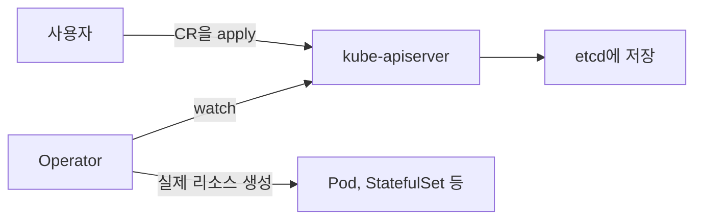

# crd
참고: kubernetes-operator.md

---

CRD는 Custom Resource Definition, 사용자 정의 리소스 정의다. Kubernetes에 원래 없는 새 종류의 리소스를 직접 등록하는 기능이다.

## Definition과 Custom Resource

Kubernetes에는 Pod, Service, Deployment 같은 기본 리소스 종류가 있다. CRD를 등록하면 그 목록에 새 종류가 추가된다.

- CRD: "이런 종류가 있고 필드는 이렇다"는 설계도다.
- Custom Resource(CR): 그 설계도로 만든 실제 객체다.

등록한 뒤에는 `kubectl apply`로 만들고 지우는 방식이 기본 리소스와 똑같다. 새 종류의 객체도 기본 리소스처럼 kube-apiserver를 거쳐 etcd에 저장된다.

## CRD만으로는 아무 일도 일어나지 않는다

CRD는 저장 형식을 정의할 뿐이다. 객체가 etcd에 저장되는 것 외에는 아무 동작이 없다. 저장된 객체를 읽고 실제 상태를 맞추는 프로그램이 필요하고, 그 역할이 kubernetes-operator.md에서 다루는 Operator다.

## Recap

CRD는 Kubernetes에 새 리소스 종류를 등록하는 설계도이고, 그 설계도로 만든 객체가 Custom Resource다. 등록하면 기본 리소스처럼 apply로 다룰 수 있지만 저장만 될 뿐이고, 객체를 보고 행동하는 Operator가 있어야 의미가 생긴다.
