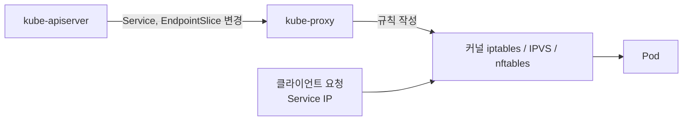

# kube-proxy
참고: kubelet.md

---

kube-proxy는 각 노드에서 Service로 들어온 트래픽이 실제 Pod로 가도록 네트워크 규칙을 관리하는 구성요소다. kubelet이 현장 소장, containerd가 작업자라면 kube-proxy는 내선 전화 교환원이다. 대표 번호(Service)로 걸려 온 전화를 지금 받을 수 있는 담당자(Pod)에게 연결해 준다.

## 왜 필요한가

Pod는 언제든 죽고 다시 만들어지며, 새로 만들어질 때마다 IP가 바뀐다. 그래서 Pod 앞에 고정된 대표 주소인 Service(예: ClusterIP)를 둔다.

여기서 풀어야 할 문제가 있다. Service의 고정 IP로 들어온 요청을 지금 살아 있는 실제 Pod IP로 어떻게 연결할 것인가. 이 변환을 각 노드에서 실제로 처리하는 것이 kube-proxy다.

## 하는 일

첫째, Service와 Pod를 연결한다. kube-proxy는 kube-apiserver를 watch하고 있다가 Service나 Pod(정확히는 그 Pod 목록인 EndpointSlice)가 생기거나 사라지면 변경을 감지한다. 그리고 "이 Service IP로 오면 이 Pod IP들로 보내라"는 규칙을 노드의 네트워크 설정에 반영한다.

둘째, 내부 로드밸런싱을 한다. 한 Service 뒤에 같은 Pod가 3개 있으면 요청이 3개로 나뉘어 전달된다. 다만 기본인 iptables 모드는 순서대로 돌리는 라운드로빈이 아니라 확률 규칙으로 무작위 선택한다. 분산 방식을 고르고 싶으면 IPVS 모드에서 라운드로빈 등을 쓸 수 있다.

## 직접 트래픽을 나르지 않는다

이름에 proxy가 들어 있어서 모든 패킷이 kube-proxy 프로세스를 통과한다고 오해하기 쉽다. proxy는 "대리인"이라는 뜻이니 이름만 보면 그렇게 읽힌다. 실제로는 다르다.

kube-proxy는 리눅스 커널의 iptables, IPVS, 최근에는 nftables에 "A 주소로 오면 B나 C로 보내라"는 규칙만 적어 두고 빠진다. 규칙이 만들어진 뒤에는 패킷을 커널이 직접 보고 Pod로 전달한다. 그래서 빠르고 부하가 적다.

이름이 이렇게 지어진 이유가 있다. 초기 kube-proxy는 userspace 모드로, 실제로 패킷을 받아서 중계하는 진짜 프록시였다. 이후 커널 규칙 방식으로 바뀌면서 역할은 달라졌지만 이름은 그대로 남았다.

Service의 ClusterIP는 어떤 네트워크 인터페이스에도 할당된 실제 IP가 아니라 가상 IP다. 그 IP를 listen하는 프로세스가 없고, 커널 규칙이 패킷의 목적지를 Pod IP로 바꿔치기할 뿐이다.

## 어떻게 떠 있는가

kubelet과 containerd는 OS의 systemd 서비스로 돌지만, kube-proxy는 그 둘이 뜬 뒤에 올라오는 Pod다. kubeadm 클러스터(Kind 포함)에서는 DaemonSet이라서 모든 노드에 하나씩 자동 배포된다. DaemonSet의 어원은 04-pod-sidecar-daemon 글에서 다뤘다.

컨트롤 플레인 노드에는 보통 Taint가 걸려 있는데, kube-proxy는 모든 Taint를 견디는 Toleration을 가지고 있어서 그 노드에도 배치된다. Taint와 Toleration은 01-taint-toleration 글에서 다뤘다.

모든 클러스터에 있는 것은 아니다. Cilium 같은 CNI는 kube-proxy 없이 자체적으로 Service 처리를 대신하는 모드를 제공한다.

## 노드의 세 구성요소

kubelet은 현장 소장이고 OS 프로세스(systemd)로 돈다. 본부의 지시를 받아 Pod 생명주기를 관리한다.

containerd는 실제 작업자이고 OS 프로세스(systemd)로 돈다. kubelet의 지시로 컨테이너를 실행하고 중지한다.

kube-proxy는 전화 교환원이고 Pod(DaemonSet)로 돈다. 노드의 네트워크 규칙을 갱신해서 Service와 Pod를 연결한다.

## Recap

kube-proxy는 모든 노드에서 Service의 가상 IP가 실제 Pod IP로 이어지도록 커널의 네트워크 규칙(iptables, IPVS, nftables)을 관리한다. 이름은 프록시지만 패킷을 직접 나르지 않고, 규칙만 적어 둔 뒤 실제 전달은 커널이 한다. 처음에는 진짜 프록시였던 이력이 이름에 남아 있다. kubelet과 containerd가 OS 프로세스인 것과 달리 kube-proxy는 DaemonSet Pod로 모든 노드에 하나씩 뜬다.
