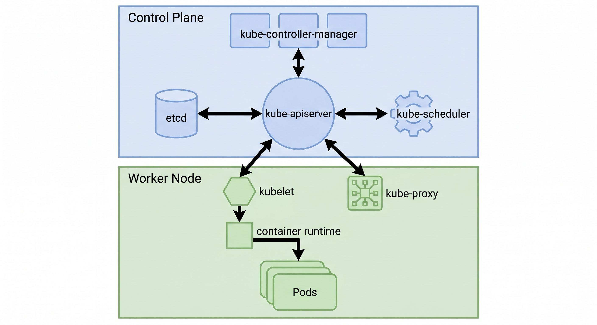

# kubelet
참고: kubernetes-container-runtime.md

---

클러스터의 모든 노드에는 kubelet과 containerd가 설치되어 있다. 워커 노드만이 아니라 컨트롤 플레인(마스터) 노드도 마찬가지다. 둘 중 하나라도 없는 노드는 클러스터의 지시를 받을 수도, 컨테이너를 띄울 수도 없는 빈 컴퓨터다.

## 역할 분담

kubelet은 노드의 현장 소장이다. 이 노드에 배정된 Pod의 명세(PodSpec)를 확인하고, 그 Pod가 정상 동작하는지 감시해서 컨트롤 플레인에 상태를 보고한다. 이름의 유래는 06-kubelet-etcd-kind-borg 글에서 다룬 대로, Kubernetes에 "작다"는 -let을 붙인 노드별 작은 에이전트다.

containerd는 실제 작업자다. kubelet의 지시를 받아 레지스트리에서 이미지를 내려받고, 컨테이너를 생성·시작·중지한다. 컨테이너 런타임이 CRI로 연결되는 구조는 kubernetes-container-runtime.md에 정리되어 있다.

정확히 말하면 화살표의 시작점은 kubelet이다. kubelet이 kube-apiserver를 watch하고 있다가 "내 노드에 배정된 Pod"가 생기면 가져가서 처리한다. apiserver가 kubelet에 직접 명령을 밀어 넣는 구조가 아니라, kubelet이 당겨 가는 구조다. kubelet과 containerd 사이의 통신은 CRI(gRPC)로 이뤄진다.

## 컨트롤 플레인 노드에도 있는 이유

kube-apiserver, etcd, kube-scheduler, kube-controller-manager 같은 컨트롤 플레인 구성요소도 결국 컨테이너로 실행된다. kubeadm으로 만든 클러스터(Kind 포함)에서는 이들이 Static Pod로 뜬다. kubelet이 노드의 지정 디렉터리(`/etc/kubernetes/manifests`)에 있는 매니페스트 파일을 직접 읽어서 띄우는 Pod다. apiserver가 아직 없어도 kubelet이 스스로 띄울 수 있다는 점이 핵심이다.

그래서 컨트롤 플레인 노드도 이 Pod들을 띄우기 위해 kubelet과 containerd를 쓴다. 다만 이는 kubeadm 방식의 구조이고, k3s처럼 구성요소를 하나의 바이너리로 묶는 배포판은 다르게 동작한다.

## 왜 Pod가 아니라 OS 프로세스인가

Kubernetes의 거의 모든 구성요소는 Pod로 뜨지만, kubelet과 containerd는 리눅스에 직접 설치된 systemd 서비스(데몬)로 실행된다. 컨테이너를 띄워 주는 프로그램 자체가 컨테이너 안에서 돌 수는 없기 때문이다. 닭이 먼저냐 달걀이 먼저냐의 문제에서, 가장 밑바닥은 OS 프로세스여야 한다.

Kind 클러스터에서는 노드 자체가 Docker 컨테이너이고, 그 안에서 systemd가 kubelet과 containerd를 띄운다. 컨테이너 안의 컨테이너 구조가 되는 이유다.

## Recap

모든 노드(워커와 컨트롤 플레인 모두)에는 kubelet과 containerd가 있다. kubelet은 apiserver에서 자기 노드의 Pod 명세를 당겨 와 상태를 감시·보고하고, 실제 컨테이너 실행은 CRI로 containerd에 맡긴다. 컨트롤 플레인 구성요소도 kubelet이 Static Pod로 띄운다. 이 둘만은 Pod가 아니라 OS의 systemd 서비스로 돈다. 컨테이너를 띄우는 기반이라서 컨테이너 안에 있을 수 없기 때문이다.
