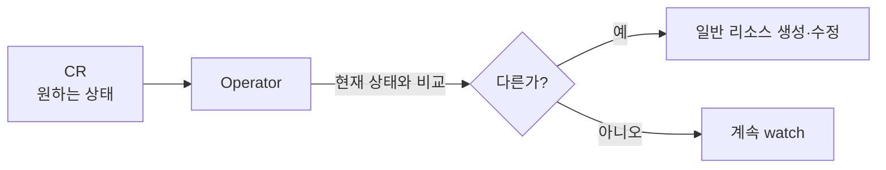

# kubernetes-operator
참고: crd.md, kubelet.md

---

Operator는 CRD로 선언한 원하는 상태를 지켜보다가, 실제 상태를 그에 맞게 맞춰 주는 컨트롤러다. 이름은 "운영자"에서 왔다. 사람 운영자가 하던 설정 변경, 재시작, 상태 확인을 소프트웨어가 대신하게 만든 것이다.

## 특정 프로그램이 아니라 패턴이다

Operator는 하나의 프로그램 이름이 아니라 "CRD와 그 CRD를 지켜보는 컨트롤러"라는 설계 패턴이다. 소프트웨어마다 자기 전용 Operator가 따로 있고, 서로의 CRD만 지켜본다. 예를 들어 Prometheus Operator는 ServiceMonitor를 읽어 수집 설정으로 번역하고, ECK Operator는 Elasticsearch 객체를 읽어 클러스터를 구성한다. 둘은 서로 다른 프로그램이지만 같은 패턴이다.

## 동작: reconcile

Operator는 kube-apiserver를 watch하다가 CR이 바뀌면 현재 상태와 비교하고, 다르면 StatefulSet, ConfigMap, Secret 같은 일반 리소스를 만들거나 고친다. 선언한 상태와 현재 상태를 끊임없이 맞추는 이 반복을 reconcile이라 한다.

Operator가 Prometheus나 Elasticsearch를 직접 실행하는 것은 아니다. 일반 리소스를 만들면 그 뒤는 평소처럼 스케줄러와 kubelet이 Pod를 띄운다.

## Operator도 Pod로 뜬다

Operator는 컨테이너 이미지로 만들어 Deployment나 StatefulSet 같은 워크로드로 클러스터 안에 띄운다. 다른 리소스를 만들고 바꿀 권한이 필요해서 ServiceAccount와 RBAC가 함께 설치되고, CRD도 같이 등록된다.

kubelet은 컨테이너를 띄우는 기반이라 OS 프로세스지만, Operator는 그 위에서 도는 평범한 애플리케이션이라서 Pod다. 이 구분은 kubelet.md에서 다룬다.

## Operator가 죽으면

Operator가 관리하던 Pod들은 그대로 돈다. 멈추는 것은 변화에 대한 반응뿐이다. CR을 새로 만들거나 고쳐도 반영되지 않다가, Operator가 다시 뜨면 그동안 쌓인 변경을 따라잡는다. 상태를 비교하는 reconcile 방식이라 가능하다.

## Recap

Operator는 CRD로 선언한 원하는 상태를 watch하고 현재 상태와 비교해 일반 리소스를 만들거나 고치는 컨트롤러이며, 특정 프로그램이 아니라 패턴이다. 자기 자신은 평범한 Pod로 뜨고, 죽어도 관리하던 Pod는 유지되며 다시 뜨면 밀린 변경을 따라잡는다.
