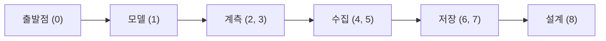
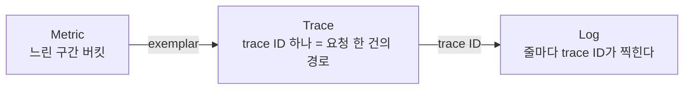

# OpenTelemetry 세미나 0회차 — Observability 기본과 기존 APM 둘러보기

> 자료: assets/opentelemetry-study/00-observability-basics.pdf (오리엔테이션 슬라이드 23장)
> 이미 정리된 개념: glossary/topics/observability/published/observability.md, signal.md. 이 문서는 0회차 슬라이드의 흐름을 한 번에 복습하기 위한 정리이고, 개념 정의는 위 파일을 기준으로 한다.

## 이 회차의 한 줄 요약

MSA에서는 "요청 하나"를 서비스 경계 너머로 따라가야 문제를 설명할 수 있다. 그런데 Metric·Log·Trace는 도구마다 계측 방식과 전파 헤더가 달라 서로 이어지지 않았고, 그래서 계측과 전송을 표준(OpenTelemetry)으로 통일하는 흐름이 생겼다.

## 1. 커리큘럼 흐름

데이터가 흐르는 순서대로 8회차가 구성된다.

- 0회차: 왜 필요한가, 지금 쓰는 도구는 무엇이 아쉬운가
- 1회차: OTel이 무엇을 표준화하는가, Trace/Metric/Log 구조, API·SDK·Collector 분리
- 2회차: 코드를 안 고치고 얼마나 얻을 수 있는가 (Zero-Code)
- 3회차: 서비스 경계와 비동기 경계를 넘을 때 context는 어떻게 따라가는가
- 4회차: Collector를 어디에 어떻게 놓는가
- 5회차: 무엇을 버리고 바꾸고, 밀릴 때 어떻게 되는가
- 6회차: 시계열 DB는 왜 그렇게 생겼고 무엇을 고르는가
- 7회차: 로그는 어디에 넣고, 오래된 로그는 어디로 보내는가
- 8회차: 한 플랫폼으로 묶으면 어떤 모양이 되는가

진행 방식과 준비물
- 회차당 1~2시간, 실습은 Java(Spring Boot) 서비스 몇 개와 Kafka
- 백엔드는 Prometheus(metric), Grafana Loki(log), Grafana Tempo(trace), Grafana(UI). 후반에 다른 플랫폼도 소개
- 환경은 회차별 Docker Compose, 실습 코드는 start/ 와 solution/
- 1회차 전까지: Docker Desktop(Compose v2)에서 docker compose version 동작 확인, 터미널에서 curl, jq 동작 확인. 회사 PC라면 Docker Desktop 라이선스 확인

## 2. Monitoring vs Observability

- Monitoring은 아는 질문(known-unknown)에 답한다. "CPU가 80%를 넘었나", "에러율이 1%를 넘었나"처럼 질문을 미리 정하고 지표와 알람을 설정한다. "무엇이 깨졌는가"에 빠르게 답한다.
- Observability는 모르는 질문(unknown-unknown)에 답할 수 있는 성질이다. 제어이론에서는 외부 출력만 보고 내부 상태를 얼마나 추론할 수 있는가를 뜻한다. 소프트웨어에서는 배포 전에 생각하지 못한 질문을, 코드를 다시 배포하지 않고 남겨 둔 데이터만으로 답할 수 있는가이고, "왜"를 설명한다.

예시 — 결제 API의 p99 지연이 오후 3시부터 올라갔다.
- 모니터링이 답하는 것: "p99가 임계치를 넘었다" 여기까지
- 관측성이 있으면 이어서 묻는다: 어느 하위 서비스에서 시간이 늘었나, 특정 사용자·결제 수단인가, 느린 요청들의 공통점은 그 시각의 배포·설정 변경인가. 어떤 축으로 자를지는 사고 당시에 정해지므로 대시보드를 미리 만들어 둘 수 없다.

MSA가 되면서 늘어난 "모르는 질문" 세 가지
- 호출 경로: 요청 하나가 몇 개 서비스를 거쳤는지 코드만 보고 파악하기 어렵다
- 구간별 시간: 전체 3초 중 어느 구간이 시간을 가장 많이 잡아먹었나
- 연결 고리: A 서비스의 로그와 B 서비스의 로그가 같은 요청인지 어떻게 아는가

세 질문 모두 "요청 하나"를 서비스 경계 너머로 따라갈 수 있어야 답할 수 있다.

## 3. 세 Signal

Metric, Log, Trace를 Signal이라 부른다. 같은 사실을 다른 해상도로 기록한 것이다.

Metric
- 일정 간격으로 집계한 숫자의 시계열 (요청 수, 에러율, p99, 힙 사용량)
- 강한 질문: 추세는, 지금 정상 범위인가, 얼마나 많이
- 비용: 요청 수와 무관하게 거의 일정. 싸고 오래 보관 가능, 알람의 재료
- 약점: 개별 요청을 볼 수 없다. 라벨을 늘리면 비용이 폭발한다 (cardinality, 6회차)

Log
- 시각이 붙은 이벤트 한 줄 (예외 스택, 입력값, 분기 결과)
- 강한 질문: 그때 정확히 무슨 일이 있었나
- 비용: 요청 수에 비례, 가장 크다
- 약점: 비정형이면 집계가 어렵다. 요청 하나를 여러 서비스 로그에서 잇기 힘들다 (어디에 둘지는 7회차)

Trace
- 요청 한 건이 거쳐 간 작업(span)들의 트리
- 강한 질문: 어디서 시간을 썼나, 어느 호출이 실패했나
- 비용: 요청 수에 비례하되 샘플링으로 조절
- 약점: 전수 저장이 어렵다. 로그만큼 상세하지 않다 (샘플링은 3회차 계측, 5회차 tail sampling)

### 셋을 잇는 열쇠

같은 요청에는 같은 trace_id를, 같은 프로세스에는 같은 service.name을 남긴다.

- 따로 저장되면 metric 대시보드에서 이상 확인 → 그 시각 로그를 열어 에러 찾기 → trace ID가 찍혀 있기를 바라며 APM 검색, 이 단계가 전부 수작업이고 하나라도 어긋나면 끊긴다
- 공통 식별자로 이으면 Metric의 튀는 점에서 그 요청의 Trace로, Trace의 한 구간에서 그 시점의 Log로 건너갈 수 있다
- 리소스 속성(서비스 이름·버전·인스턴스·환경)도 세 signal에 같은 이름·형식으로 붙어 있어야 "이 서비스의 이 버전"으로 묶어 볼 수 있다
- 이 이름·형식을 통일하는 것이 OTel이 하는 일의 큰 부분이다. 1회차에서 Resource와 공통 데이터 모델로, 2회차에서 Grafana에서 실제로 서로 넘어가는 모습으로 확인한다

## 4. 왜 표준화가 필요해졌나

signal마다 도구 생태계가 달라서 계측 코드가 백엔드에 결합되는 문제가 있었다.
- Metric: Prometheus client, StatsD, Dropwizard, Micrometer. 이름 규칙과 전송 형식이 제각각
- Trace: Zipkin, Jaeger, Pinpoint. 계측 API도 헤더 형식(B3, uber-trace-id, 벤더 헤더)도 제각각
- Log: logback/log4j → 파일 → Fluentd, Promtail. trace와 이으려면 MDC에 trace id를 넣고 하나하나 검색해야 한다

두 표준화 시도가 합쳐졌다.
- OpenTracing (CNCF): 벤더 중립 trace API만 정의
- OpenCensus (Google): API + 구현 + metric까지 묶음
- 둘이 결합해 OpenTelemetry (2019~, CNCF): 세 signal, 다언어, 벤더 중립을 하나의 프로젝트로

## 5. 기존 APM 둘러보기

어떤 APM이든 4단계 구조다: 계측(앱 안, agent 또는 SDK) → 전송(프로세스 밖, 벤더 프로토콜 또는 표준) → 저장(시계열·문서·열 지향) → 분석(UI·알람·대시보드)

비교할 때 볼 다섯 축
- 계측 방식: 코드를 고치는가(SDK), 안 고치는가(bytecode agent). 지원 언어는
- signal 범위: trace만인가, metric·log까지 한 곳에서 보는가
- 전송 규격: 벤더 고유인가, 표준(OTLP 등)인가. 요청 사이에 전파하는 헤더는 무엇인가
- 배포 모델: SaaS인가 직접 운영인가. 저장소는 무엇인가
- 종속 지점: 백엔드를 바꾸려 할 때 애플리케이션 쪽에서 무엇을 갈아야 하는가

### Pinpoint
- 네이버가 공개한 오픈소스 APM (Apache 2.0). Java 중심, PHP·Python 등도 agent 지원
- 계측: Java는 bytecode를 조작하는 agent, 애플리케이션 코드 수정 불필요
- 전송·저장: 자체 프로토콜로 Collector → HBase. 전파 헤더도 자체(Pinpoint-TraceID 등)
- 강점: 서버 맵과 call tree(어느 메서드에서 얼마나 썼는지)가 상세. 비용은 운영 인건비
- 약점: trace 중심이라 metric·log는 다른 도구 필요. HBase 운영 난이도. 헤더·프로토콜이 고유해 다른 도구와 trace를 잇기 어렵다

### Datadog
- SaaS. 호스트마다 Datadog Agent, 애플리케이션에는 언어별 트레이싱 라이브러리(dd-trace)
- trace·metric·log를 한 UI에서 보며 서로 넘어가는 경험이 좋다. 인프라·보안·RUM까지 제품군이 넓다
- 비용: 호스트 수, 수집량, 커스텀 metric 수 등 여러 축으로 과금. 규모가 커질수록 비용 설계가 운영 과제
- 종속: 계측 라이브러리·agent·헤더(x-datadog-*)가 고유. 최근 OTLP 수신과 OTel Collector 배포판(DDOT)으로 OTel 계측도 받아들인다

### Elastic APM
- agent → APM Server → Elasticsearch → Kibana
- 강점: 로그를 이미 ES에 넣고 있다면 trace와 같은 저장소, 전문 검색
- 약점: ES 운영 부담(샤드·인덱스 수명 주기·메모리). 시계열 metric은 전용 TSDB보다 비효율
- 방향: 자체 agent 대신 OTel 기반 배포판 EDOT을 전면에

### AWS CloudWatch + X-Ray
- CloudWatch가 metric·log, X-Ray가 trace. ALB·Lambda·API Gateway 계측은 기본 제공
- 강점: AWS 안에서는 설정이 적고 관리형
- 약점: trace 모델과 헤더(X-Amzn-Trace-Id)가 고유. AWS 밖에서는 쓸 수 없다. 로그 쿼리·보존 비용 별도
- 방향: OTel 배포판 ADOT. 계측은 OTel, 백엔드만 AWS를 권장

### 오픈소스 조합 (이 세미나의 실습 백엔드)
- Jaeger 또는 Zipkin + Prometheus + Loki 또는 ES + Grafana
- 강점: 각 도구가 자기 signal에 특화. 비용은 운영뿐
- 약점: 도구마다 계측 라이브러리·전송 규격이 다르다 (B3, uber-trace-id, pull exporter, 별도 로그 수집기). 세 signal을 잇는 ID·속성 맞추기가 전부 사용자 몫
- 변화: Jaeger는 자체 클라이언트를 폐기하고 OTel SDK 권장. Grafana 스택은 OTLP 수신이 기본

### 도구별 비교 정리
- Pinpoint: 자체 agent / Pinpoint-* / trace 중심 / 직접 운영(HBase)
- Datadog: dd-trace + Agent / x-datadog-* / trace·metric·log / SaaS
- Elastic APM: 자체 agent에서 EDOT으로 이동 중 / W3C 지원 / trace·metric·log / 직접 운영 또는 Cloud
- CloudWatch + X-Ray: X-Ray SDK 또는 ADOT / X-Amzn-Trace-Id / trace·metric·log / 관리형(AWS 한정)
- OSS 조합: 도구별 라이브러리 / B3, uber-trace-id 등 / 도구별 / 직접 운영

세 가지 공통 한계
- 계측이 백엔드에 결합: 백엔드를 바꾸면 애플리케이션 계측을 갈아엎어야 한다
- 전파 헤더가 제각각: A는 Pinpoint, B는 Zipkin이면 둘 사이에서 trace가 끊긴다
- 연결은 벤더 안에서만: log는 ES, trace는 Jaeger면 사용자가 노가다로 ID를 찾아 검색한다

최근에는 계측과 전송은 표준(OTel)에 맡기고, 저장과 분석에서 경쟁하는 케이스가 늘고 있다. DDOT·EDOT·ADOT은 전부 OTel 배포판이다.

## 6. 실무에서 부딪히는 쟁점 다섯 가지

데이터를 많이 모을수록 좋지만 비용도 같이 오른다. 이 세미나에서 반복해 나올 주제다.
- 카디널리티: metric 라벨 조합 수. 사용자 ID·요청 ID 같은 고유 값을 라벨로 쓰면 시계열이 폭발한다 → 6회차
- 샘플링: trace를 전부 저장할 것인가. 앞에서(head) 확률로 자를 것인가, 끝까지 보고(tail) 에러·느린 요청만 남길 것인가 → 5회차
- 보존과 비용: 로그를 며칠 두는가. 뜨거운(hot) 저장소와 차가운(cold) 저장소를 나눌 것인가 → 7회차
- 이름 규칙: http.status_code인가 status인가 httpStatus인가. 팀마다 다르면 대시보드도 알람도 공유되지 않는다 → 1회차 semantic conventions
- 파이프라인 신뢰성: 수집기가 밀리면 데이터를 버릴 것인가, 애플리케이션을 막을 것인가 → 5회차 back pressure

## 7. 흔한 오해

- "로그를 많이 남기면 관측성이 생긴다": 양이 아니라 이을 수 있는가가 핵심. ID 없는 로그 100GB보다 trace ID가 찍힌 로그 1GB가 낫다
- "APM을 도입하면 끝난다": APM은 보통 trace와 일부 metric에 강하다. 로그, 비용 모델, 그 벤더 밖으로 나갈 때의 문제는 남는다
- "trace는 마이크로서비스에서만 필요하다": 모놀리스 안에서도 "이 요청이 DB에 몇 번 갔고 어디서 200ms를 썼나"는 trace가 가장 잘 답한다

관측성이란 임의의 축으로 자르고, 다른 데이터와 이을 수 있는가이다.

## 8. 이 회차 이후 확인할 것

- 이 세미나에서 쓰는 실제 도구 구성은 스터디 README.md의 "사용 도구"와 슬라이드의 "진행 방식" 사이에 약간 차이가 있다 (README는 OpenSearch/Loki, Tempo, VictoriaMetrics, 슬라이드는 Prometheus, Loki, Tempo, Grafana). 1회차에서 최종 구성을 확인한다
- 참고 자료 (슬라이드 원문 출처): OTel 공식 문서의 What is OpenTelemetry?, Observability primer / Observability Engineering (O'Reilly, 2022) / Peter Bourgon "Metrics, tracing, and logging" (2017) / Google SRE Book의 Monitoring Distributed Systems / Pinpoint GitHub / Datadog·Elastic·AWS의 OTel 문서
