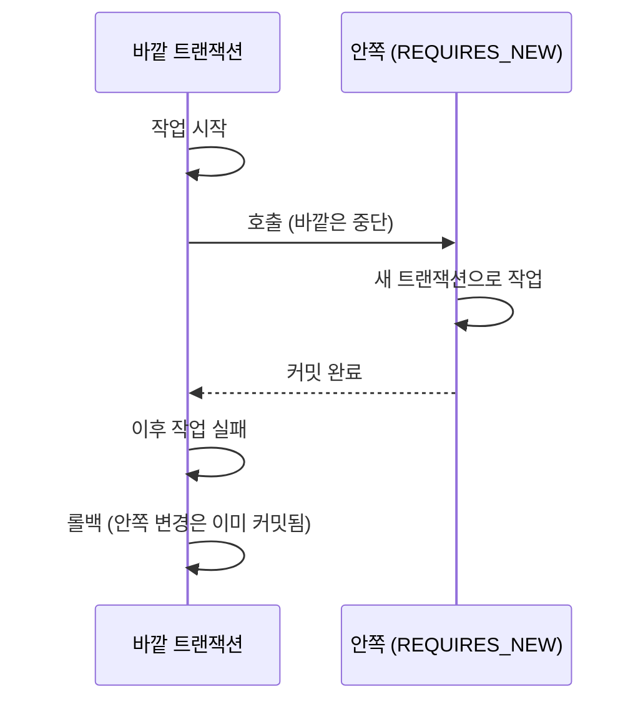

# REQUIRES_NEW

`@Transactional(propagation = Propagation.REQUIRES_NEW)`는 이미 진행 중인 트랜잭션이 있어도 그걸 잠시 멈추고, 새 트랜잭션을 따로 열어서 실행하는 전파 속성이다. 안쪽 작업은 바깥 트랜잭션과 상관없이 자기만의 커밋/롤백으로 끝난다.

## REQUIRED와의 차이

기본값인 `REQUIRED`는 바깥 트랜잭션이 있으면 거기에 참여한다. 하나의 트랜잭션이라서 바깥이 롤백되면 안쪽 변경도 같이 사라진다.

`REQUIRES_NEW`는 바깥을 일시 중단하고 새 커넥션으로 새 트랜잭션을 연다. 안쪽이 먼저 커밋되기 때문에 바깥이 나중에 롤백돼도 안쪽 변경은 남는다.

## 필요한 상황

바깥 결과와 무관하게 남겨야 하거나 독립시켜야 할 때 쓴다.

- 기록을 반드시 남겨야 할 때: 바깥이 실패해도 남아야 하는 감사 로그, 실패 이력, 외부 리소스 추적 기록이다. 외부 시스템에 이미 만든 리소스가 있는데 DB 기록이 같이 롤백되면 그 리소스가 있다는 단서가 사라진다.
- 반복 작업을 건별로 독립시킬 때: 여러 건을 순회하며 처리할 때 한 건이 실패해도 앞서 성공한 건이 롤백되면 안 되는 경우다.

## 쓰면 안 되는 상황

바깥 작업과 같이 성공하거나 같이 실패해야 할 때는 쓰지 않는다. 비즈니스 변경과 이벤트를 같은 트랜잭션에서 저장해야 하는 Outbox 패턴이 대표적이다. 따로 커밋되면 비즈니스가 롤백돼도 이벤트만 남는다.

## 주의할 점

- 바깥이 이미 잡은 행을 안쪽이 쓰려고 하면 lock 대기로 교착된다. 바깥이 안 끝나고 안쪽이 바깥을 기다리는 구조다. 같은 행에 대한 쓰기는 일부만 독립시키지 말고 일관되게 다룬다.
- 안쪽이 커넥션을 하나 더 쓴다. 바깥이 커넥션을 쥔 채 안쪽이 새 커넥션을 요청하므로, 풀이 작으면 고갈될 수 있다.
- 바깥의 아직 커밋되지 않은 변경은 안쪽에서 보이지 않는다.
- 같은 클래스 안에서 호출하면 프록시를 거치지 않아 적용되지 않는다. 별도 빈으로 분리해야 한다. 참고: cglib-proxy.md
- 안쪽에서 던진 예외를 바깥이 잡지 않으면 그대로 전파돼서 바깥도 롤백된다. 안쪽 실패가 바깥에 영향을 주지 않게 하려면 바깥에서 잡아야 한다.

## 내가 쓴 곳

third-api의 더미 포트 점유 기록은 LB 생성 트랜잭션이 롤백돼도 남아야 해서 쓰기 메서드를 전부 REQUIRES_NEW로 했다. OpenStack에 실제 포트가 만들어졌는데 기록이 같이 롤백되면 그 포트를 정리할 단서가 없어진다. 실제로 Citrix 연결 실패로 LB가 롤백됐을 때도 기록이 남아 release로 정리됐다.

결제 복구에서는 오래된 PENDING 주문을 건별로 처리하는 메서드에 썼다. 주문 하나가 실패해도 다른 주문의 반영이 롤백되지 않아야 하고, PG 호출은 트랜잭션 밖에서 하기 위해 별도 빈으로 뺐다.

같은 프로젝트의 OutboxEventListener는 반대로 REQUIRES_NEW를 REQUIRED로 되돌렸다. outbox 저장이 비즈니스 변경과 같이 롤백돼야 했기 때문이다.

## Recap

REQUIRES_NEW는 바깥 트랜잭션을 멈추고 독립된 트랜잭션을 연다. 바깥이 실패해도 남겨야 하는 기록이나 건별로 독립시켜야 하는 작업에 쓰고, 바깥과 함께 움직여야 하는 작업에는 쓰지 않는다. 쓸 때는 같은 행에 대한 lock 교착, 커넥션 추가 사용, 같은 클래스 내부 호출에서 적용되지 않는 점을 조심한다.
