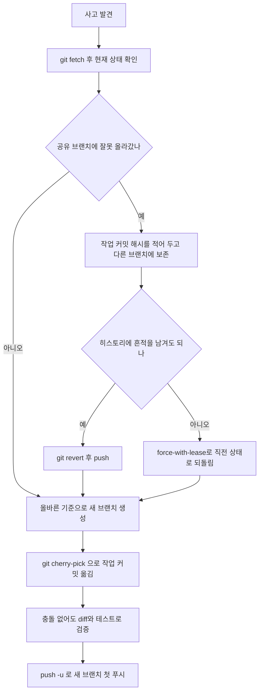

# 브랜치를 잘못 따고, 공유 브랜치에 잘못 푸시했을 때 복구하는 법

third-api에서 실제로 겪은 일을 정리한 복구 절차다. 두 가지 사고가 한 번에 났다.

- 머지 대상이 아닌 브랜치(main)에서 작업 브랜치를 땄다 (okestro-csp-user)
- 새 브랜치에서 푸시했는데 공유 브랜치(develope-dj)로 올라가 버렸다 (third-api)

복구하면서 쓴 명령은 몇 개 안 된다. 어려운 건 명령이 아니라 어떤 순서로, 무엇을 먼저 확인하고 쓰느냐다.

## 먼저 알아야 할 것 세 가지

### 1. 커밋은 사라지지 않는다
푸시한 커밋이든 되돌린 커밋이든, 해시만 알면 다시 꺼낼 수 있다. 브랜치는 커밋을 가리키는 이름표일 뿐이다. 그래서 무언가를 지우기 전에 작업 커밋이 다른 이름표에 붙어 있는지부터 확인한다.

- `git log --oneline -5` 로 해시를 적어 둔다
- 해시를 잃어버렸으면 `git reflog` 로 찾는다 (HEAD가 움직인 기록이 시간순으로 나온다)

### 2. 브랜치를 만들 때 upstream이 자동으로 붙을 수 있다
upstream은 "이 로컬 브랜치의 짝이 되는 원격 브랜치"다. 푸시할 때 대상 이름을 따로 안 적으면 이 짝으로 올라간다.

git은 새 브랜치의 시작점이 리모트 추적 브랜치(`origin/xxx`)일 때 upstream을 자동으로 붙인다.

- `git switch -c new origin/develope-dj` 는 붙는다
- `git checkout -b new origin/develope-dj` 도 붙는다
- `git checkout -b new develope-dj` (로컬 브랜치가 시작점) 는 안 붙는다
- `git checkout -b new` (시작점 생략) 도 안 붙는다

이번 사고가 정확히 이 경우였다. 브랜치 이름은 `feat/...-v2` 였지만 upstream이 `origin/develope-dj` 라서, IDE의 Push 버튼이 `develope-dj` 로 보냈다. 터미널에서 이름 없이 `git push` 만 했다면 git이 "upstream 이름이 다르다"며 막아 준다. 막히지 않고 올라갔다면 IDE의 Push를 의심한다.

확인은 `git branch -vv` 로 한다. 대괄호 안이 upstream이다.

### 3. 공유 브랜치의 히스토리를 고치는 건 위험하다
이미 다른 사람이 pull했을 수 있는 브랜치를 `reset` + `force push` 로 고치면, 그 사람의 로컬과 원격이 어긋난다. 그래서 선택지가 둘로 갈린다.

- revert 커밋을 추가한다: 안전하다. 히스토리에 커밋과 revert가 둘 다 남는다
- reset 후 force push로 지운다: 깔끔하지만 위험하다. 사이에 남이 푸시했으면 그 작업이 날아간다

이번에는 "기록을 남기고 싶지 않다"는 요구가 있어서 후자를 골랐다. 그래서 `--force-with-lease` 를 썼다 (아래 참고).

## 전체 흐름



## 단계별 명령

### 0. 먼저 현실을 확인한다
```bash
git fetch origin
git branch --show-current
git status --short
git log --oneline -6 --decorate
git branch -vv
git ls-remote --heads origin <브랜치>
```
이 단계에서 보려는 것은 세 가지다. 작업 커밋의 해시, 원격 브랜치가 지금 어떤 커밋을 가리키는지, 그 사이에 남의 커밋이 끼었는지.

원격 브랜치 위에 내 커밋 하나뿐인지는 이렇게 본다.
```bash
git log --oneline <사고 전 커밋>..origin/<브랜치>
```
내 커밋만 나오면 안전하게 되돌릴 수 있다.

### 1. 공유 브랜치에 잘못 올라간 걸 되돌린다

흔적을 남겨도 될 때 (권장):
```bash
git switch <공유 브랜치>
git revert <커밋해시>
git push
```

흔적을 남기고 싶지 않을 때:
```bash
git reset --hard <사고 전 커밋>
git push --force-with-lease=<브랜치>:<현재 원격 해시> origin <브랜치>
```

`--force-with-lease=<브랜치>:<해시>` 는 "원격이 지금 이 해시일 때만 덮어써라"라는 뜻이다. 그 사이 누가 푸시했으면 실패하고 아무것도 덮어쓰지 않는다. 그냥 `--force` 는 쓰지 않는다.

이 명령 전에 작업 커밋이 다른 로컬 브랜치에 붙어 있는지 반드시 확인한다. 이번에는 `v2` 브랜치가 같은 커밋을 가리키고 있어서 `reset --hard` 로 공유 브랜치를 되돌려도 작업이 남았다.

브랜치 보호 규칙이 있으면 force push 자체가 막힐 수 있다.

### 2. 올바른 기준으로 새 브랜치를 만든다
```bash
git fetch origin
git switch -c <새 브랜치> --no-track origin/<머지 대상 브랜치>
```
`--no-track` 이 이 문서의 핵심이다. 이걸 붙이면 upstream이 안 생겨서 같은 사고가 반복되지 않는다.

### 3. 작업 커밋을 옮긴다
```bash
git cherry-pick <커밋해시>
```
여러 개면 오래된 것부터 차례로 쓰거나 범위로 쓴다.
```bash
git cherry-pick <시작해시>^..<끝해시>
```
기준 브랜치만 바꾸고 싶으면 `rebase --onto` 도 있다.
```bash
git rebase --onto origin/<대상> <잘못 딴 기준> <작업 브랜치>
```
rebase는 이미 푸시한 브랜치면 force push가 필요해서, 새 브랜치로 cherry-pick하는 쪽이 보통 더 간단하다.

### 4. 충돌이 없어도 검증한다
cherry-pick이 "충돌 없이 성공"해도 코드가 맞다는 뜻이 아니다. 같은 파일의 다른 위치를 양쪽이 고쳤으면 git이 조용히 둘 다 살려 버린다. 이번에도 이 일이 났다.

- 기준 브랜치가 그 사이에 `makeMonitor` 조건을 바꿨다
- 내 커밋은 옛 조건을 포함한 블록을 들고 있었다
- 병합 결과로 `makeMonitor` 호출이 두 번 남았고, 한쪽은 들여쓰기까지 어긋났다
- 충돌 마커는 하나도 없었다

그래서 충돌 마커를 찾는 게 아니라 의미를 확인한다.
```bash
git diff -w origin/<대상> -- <파일>
```
공백을 무시하고 대상 브랜치와 비교했을 때, 내가 의도한 추가분만 나와야 한다. 기존 로직이 빠지거나 바뀐 줄이 보이면 병합이 어긋난 것이다.

옛 작업본과도 비교한다.
```bash
git diff -w <옛 작업 커밋> HEAD -- <파일>
```
차이가 나는 곳이 전부 "기준 브랜치가 먼저 바꾼 내용"이어야 정상이다.

그리고 테스트를 돌린다.

### 5. 첫 푸시는 이름을 명시한다
```bash
git push -u origin <새 브랜치>
```
`-u` 는 푸시하면서 upstream을 같은 이름의 원격 브랜치로 설정한다. 그 뒤에는 IDE의 Push 버튼도 이 브랜치로만 간다.

## 커밋을 합치거나 풀 때

### 커밋 두 개를 하나로 합치기
```bash
git reset --soft HEAD~2
git commit -m "..."
git push --force-with-lease=<브랜치>:<현재 원격 해시> origin <브랜치>
```
`--soft` 는 커밋만 풀고 변경 사항은 스테이징된 채로 남긴다. 이미 푸시한 브랜치면 force push가 필요하다.

머지할 때 Bitbucket의 Squash 옵션을 쓰면 force push 없이도 한 커밋으로 들어간다.

### 커밋을 풀어서 추가 작업과 한 번에 커밋하기
```bash
git reset --soft HEAD~1
```
커밋되지 않은 상태로 돌아가서, 추가 작업을 하고 한꺼번에 커밋할 수 있다. 푸시하지 않은 로컬 커밋에만 쓴다.

`--soft` 와 `--hard` 의 차이를 헷갈리지 않는다.
- `--soft`: 커밋만 푼다. 변경 사항은 스테이징된 채 남는다
- `--mixed` (기본값): 커밋과 스테이징을 푼다. 변경 사항은 파일에 남는다
- `--hard`: 변경 사항까지 전부 버린다

## 함정 모음

### GitHub CLI는 Bitbucket에서 안 된다
`gh` 는 GitHub 전용이다. 이 레포의 원격은 Bitbucket이라 PR을 조회하지 못한다. PR 대상 브랜치와 커밋 목록은 화면에서 보거나, 로컬에서 이렇게 계산한다.
```bash
git log --oneline origin/<대상>..origin/<내 브랜치>
git diff --stat origin/<대상>...origin/<내 브랜치>
```
점 세 개(`...`)는 두 브랜치가 갈라진 지점부터 비교한다. PR이 보여 주는 변경 범위와 같다.

### 명령을 && 와 파이프로 이으면 실패가 숨는다
`테스트 | tail && git commit && git push` 같은 체인에서는 테스트가 실패해도 `tail` 의 종료 코드가 0이라 커밋과 푸시가 그대로 진행된다. 이번에 실제로 겪었다.

- 테스트 결과는 파일로 받고 종료 코드를 따로 확인한다
- 푸시 같은 되돌리기 어려운 동작은 검증 뒤에 별도 명령으로 한다

### 이 레포의 테스트는 clean 없이 돌리면 컴파일이 실패한다
third-api는 Maven 프로젝트이고 QueryDSL이 Q클래스를 생성한다. `target` 에 이전 Q클래스가 남은 채로 다시 빌드하면 `Attempt to recreate a file for type ...Q...` 에러가 수십 줄 나오면서 컴파일이 실패한다. 테스트 코드 문제가 아니다.
```bash
./mvnw -o clean test -Dtest='클래스1,클래스2'
```

### @Nested 테스트는 바깥 클래스 줄에 0으로 찍힌다
Maven 요약에서 `Tests run: 0 -- in 바깥클래스` 로 보여도 실제 테스트는 `바깥클래스$안쪽클래스` 줄에 따로 집계된다. 합계에는 들어 있다.

### @RequiredArgsConstructor 서비스를 테스트에서 new 로 만들 때
서비스에 필드가 추가되면 생성자 인자가 늘어난다. 테스트가 `new 서비스(...)` 를 직접 호출하면 인자 개수가 안 맞아 컴파일이 깨진다. cherry-pick으로 기준 브랜치의 필드가 늘어난 서비스를 가져올 때 특히 조심한다. 이번에는 `WebClient citrixPartitionWebClient` 인자가 빠져 있었다.

## 사고 예방 체크리스트

- 브랜치를 딸 때 시작점이 `origin/...` 이면 `--no-track` 을 붙인다
- 딴 직후 `git branch -vv` 로 대괄호 안(upstream)을 본다
- 첫 푸시는 `git push -u origin <내 브랜치 이름>` 으로 이름을 명시한다
- IDE에서 푸시할 때는 Push 창의 대상 브랜치가 내가 만든 이름인지 본다
- 머지 대상 브랜치가 뭔지 먼저 확인하고 그 브랜치에서 딴다

## 이번 사고를 reflog로 읽는 법
사고 원인을 추적할 때 `git reflog --date=format:'%m-%d %H:%M'` 이 유용했다. HEAD의 이동 기록이 시간순으로 남는다.

- `checkout: moving from A to B` 는 브랜치 전환이다
- `commit`, `commit (cherry-pick)`, `commit (amend)` 는 커밋 종류를 알려 준다
- `reset: moving to <해시>` 는 reset이 어디로 갔는지 보여 준다

다만 푸시는 reflog에 기록되지 않는다. 푸시가 어디로 갔는지는 `git ls-remote --heads origin <브랜치>` 와 `git branch -vv` 로 확인한다.

## Recap
브랜치를 잘못 땄거나 공유 브랜치에 잘못 푸시했을 때의 복구는 "작업 커밋 해시를 지키고, 올바른 기준 브랜치에서 `--no-track` 으로 새로 따서 cherry-pick하고, 이름을 명시해서 첫 푸시를 한다"로 요약된다. 공유 브랜치를 되돌릴 때는 기본이 revert이고, 흔적을 지우려면 `--force-with-lease` 로 직전 상태를 못 박아서 덮어쓴다. cherry-pick은 충돌 없이 끝나도 의미가 맞다는 보증이 아니므로 대상 브랜치와 공백 무시 diff를 비교하고 테스트로 확인한다. 사고의 근본 원인은 브랜치를 `origin/xxx` 에서 따면 upstream이 자동으로 붙고, 이름 없는 푸시가 그 upstream으로 간다는 점이다.
